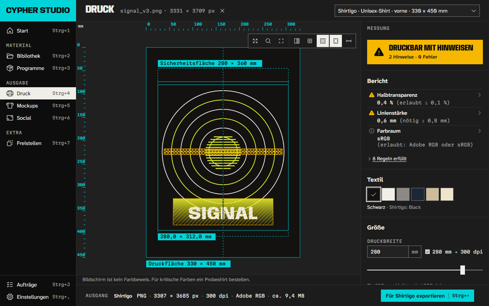

# Cypher Studio

Die Zentrale des Cypher Kollektivs für Windows, macOS und Linux. Cypher Studio lädt Krita, Inkscape, Blender und Kdenlive aus ihren offiziellen Quellen, prüft jede Datei, richtet die Programme mit unseren Farben, Schriften und Vorlagen ein und bringt eigene Werkzeuge mit: Druckdateien für Shirtigo prüfen und exportieren, Mockups, Social-Formate und eine gemeinsame Bibliothek.



**Herunterladen:** [studio.cypherxcypher.de](https://studio.cypherxcypher.de) (erkennt dein System, ein Klick). Anleitung: [In 30 Minuten startklar](https://studio.cypherxcypher.de/anleitung/).

## Was Cypher Studio kann

| Bereich | Was passiert |
|---|---|
| **Programme** | Krita (Malen/Foto), Inkscape (Vektor/Druck), Blender (3D), Kdenlive (Video). Vor jeder Installation zeigt die App Quelle · Version · Größe · Lizenz · Prüfsumme · Zielordner und fragt nach. Geladen wird nur von den offiziellen Servern; passt die Prüfsumme nicht, wird nichts installiert. Ohne Adminrechte, vorhandene Installationen werden erkannt. Affinity steht nur als Verweis da. |
| **Cypher-Einrichtung** | Paletten, freie Schriften (OFL), Vorlagen in Shirtigo-Druckmaßen und Social-Formaten, Arbeitsflächen, Export-Voreinstellungen. Jeder Baustein einzeln, mit Sicherung und Rückgängig. |
| **Blender** | App-Vorlage im PS2-Retro-Stil und die Erweiterung „Cypher Export“: prüft Polygon- und Texturbudgets und exportiert shop-fertige `.glb` nach den Konventionen des 3D-Shops. |
| **Kdenlive** | Titelvorlagen (Bauchbinde, Titelkarte, Reel-Hook, Untertitel) und Projektprofile 1080 × 1920 und 1080 × 1350. |
| **Druck** | Prüft Motive gegen die Shirtigo-Vorgaben (Druckfläche, 300 dpi, Halbtransparenz, Linienstärke, Pixelgrenzen) und exportiert die Druckdatei passend. |
| **Mockups** | Shirt und Hoodie, vorne und hinten, in allen Kollektionsfarben (Grundlagen selbst in Blender gerendert). |
| **Social** | Post 1080 × 1350, Story/Reel 1080 × 1920 und Reel-Cover mit Sicherheitszonen. |
| **Bibliothek** | Ein gemeinsamer Ordner, den jede Person mit ihrem vorhandenen Sync-Werkzeug teilt (z. B. Google Drive, Nextcloud, Syncthing). Keine Konten, keine Kosten. |
| **Freistellen** | Hintergrund per Farbschlüssel entfernen (lokal). |
| **Updates** | Die App aktualisiert sich selbst (signierte Updates). Der Programm-Katalog ist signiert und lässt sich ohne App-Update erneuern. |

Keine Telemetrie, keine Konten. Netzwerkzugriffe gehen nur an die offiziellen Programmquellen und an `studio.cypherxcypher.de`; die vollständige Liste der Adressen steht in den Einstellungen unter „Netzwerk und Daten“.

## Warnung beim ersten Start

Die Installer sind (noch) nicht mit einem gekauften Zertifikat signiert. Windows zeigt deshalb „Der Computer wurde durch Windows geschützt“ (→ „Weitere Informationen“ → „Trotzdem ausführen“), macOS meldet einen nicht verifizierten Entwickler (→ Systemeinstellungen → Datenschutz & Sicherheit → „Dennoch öffnen“). Die genaue Anleitung mit Bildern steht auf [studio.cypherxcypher.de](https://studio.cypherxcypher.de/#installieren). Die SHA-256-Prüfsummen jeder Datei stehen auf der Seite.

## Aufbau

```
apps/desktop/      Tauri-2-App: React-Oberfläche (src/) und Tauri-Schicht (src-tauri/)
crates/            cypher-core (Rust-Kern ohne Tauri) und cypher-cli (Kommandozeile für Pflege und Tests)
catalog/           signierter Programm-Katalog (catalog.json + .minisig) und öffentliche Schlüssel
packs/             Einrichtungspakete: Krita, Inkscape, Blender, Kdenlive, Schriften, Vorlagen, Mockups, Social
site/              Downloader-Seite studio.cypherxcypher.de (Cloudflare Workers Static Assets)
docs/              Architektur, Design, Recherche, Berichte, Bildschirmfotos
scripts/           Build in der WSL, Katalog signieren
```

Technik: Tauri 2 (Rust) + React 19 + TypeScript + Vite. Warum: klein (Windows-Setup ≈ 16 MB), Rechte-Modell mit minimalen Freigaben, ein Code für drei Systeme.

## Entwickeln und bauen

Siehe [docs/BAUEN.md](docs/BAUEN.md) (Tests, Builds in der WSL, E2E gegen die echte App) und [docs/ARCHITEKTUR.md](docs/ARCHITEKTUR.md). Designvertrag: [docs/DESIGN.md](docs/DESIGN.md), [docs/CONCEPT.md](docs/CONCEPT.md).

Programm-Katalog pflegen: `catalog/catalog.json` ändern, Sequenz erhöhen, dann
`node scripts/sign-catalog.mjs --key <pfad>/catalog.key --password-file <datei>` (nur lokal, nie in CI).

## Lizenz

Eigener Code: MIT ([LICENSE](LICENSE)). Blender-Erweiterung: GPL-3.0-or-later. Mockup-Grundlagen: CC0. Schriften: OFL 1.1. Name und Logo des Kollektivs sind nicht frei lizenziert. Alle Drittbausteine: [THIRD_PARTY.md](THIRD_PARTY.md).

Krita, Inkscape, Blender und Kdenlive sind Marken ihrer jeweiligen Inhaber. Cypher Studio ist ein unabhängiges Projekt und mit keinem dieser Projekte und mit keinem anderen Softwarehersteller verbunden.
