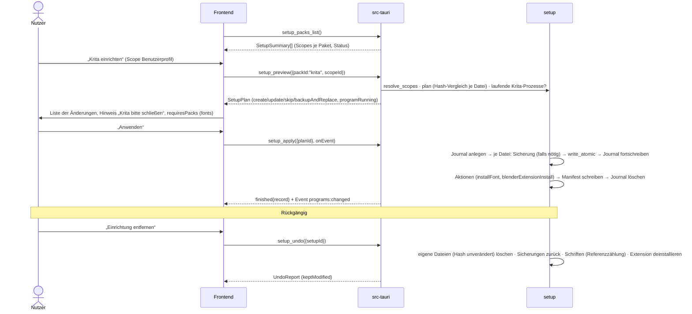
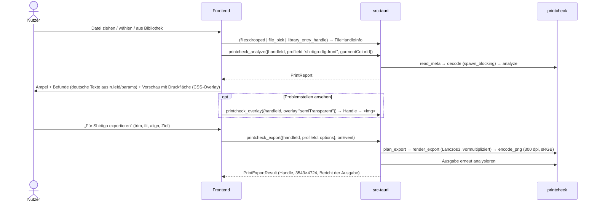
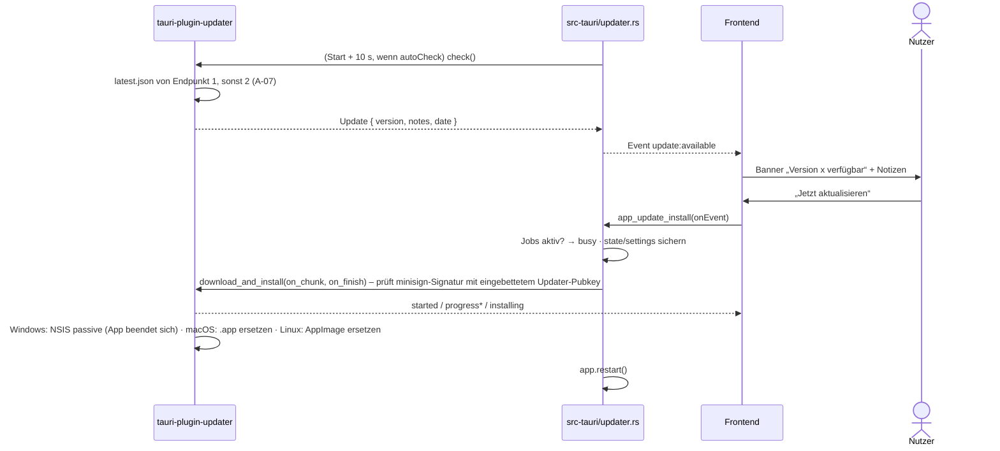

# Cypher Studio – Architektur

Version 0.1 · 16.10.2026 · Status: **Entwurf zur Umsetzung** · Begleitdatei: [`docs/ipc-contract.ts`](ipc-contract.ts) (kanonischer IPC-Vertrag)

Zielgruppe: Entwickler (auch KI-Entwickler auf Sonnet-Niveau), die parallel in getrennten Dateibereichen bauen. Alles, was mit **ANNAHME A-xx** markiert ist, wurde ohne fertige Recherche festgelegt und wird durch die Berichte in `docs/research/` (programme.md, catalog-draft.json, vorgaben.md, plattform.md) bestätigt oder ersetzt. Annahmen sind so gewählt, dass eine Korrektur **Daten** ändert (Katalog, Druckprofil, Paket-Manifest), nicht Code.

## Inhalt

0. [Überblick, Leitentscheidungen, Technikwahl, Annahmen](#0-überblick)
1. [Repo-Layout und Dateibereiche der Bauteams](#1-repo-layout-und-dateibereiche)
2. [Rust-Kern: Module und öffentliche API](#2-rust-kern-module-und-öffentliche-api)
3. [IPC-Vertrag: Commands, Channels, Events, Fehler](#3-ipc-vertrag)
4. [Datenmodelle](#4-datenmodelle)
5. [Abläufe](#5-abläufe)
6. [Sicherheitsmodell](#6-sicherheitsmodell)
7. [Plattform-Details](#7-plattform-details)
8. [Teststrategie und Qualitätstore](#8-teststrategie-und-qualitätstore)
9. [Bauplan, Meilensteine, Risiken](#9-bauplan-meilensteine-risiken)
10. [Externe Bausteine (Vorlage für THIRD_PARTY.md)](#10-externe-bausteine)

---

## 0. Überblick

### 0.1 Produkt in einem Absatz

Cypher Studio ist die Zentrale des Cypher Kollektivs: eine Desktop-App (Windows, macOS, Linux, deutschsprachig), die freie Profiprogramme (Krita, Inkscape, Blender, Kdenlive) aus offiziellen Quellen geprüft und ohne Adminrechte installiert, startet und mit einer **Cypher-Einrichtung** versieht (Paletten, OFL-Schriften, Vorlagen, Export-Voreinstellungen, Blender-Add-on). Dazu kommen eigene Module: **Druckprüfer** mit Export nach Shirtigo-Vorgaben, **Mockup-Generator**, **Social-Generator** und eine **gemeinsame Bibliothek**, die ohne Konten und laufende Kosten über einen geteilten Ordner funktioniert. Die App aktualisiert sich über den Tauri-Updater, der Programm-Katalog unabhängig davon über eine signierte JSON-Datei. Es gibt keinen Adobe-Nachbau, keine Adobe-Namen und keine Adobe-Assets.

### 0.2 Leitentscheidungen

| Nr. | Entscheidung | Grund |
|---|---|---|
| L1 | Der **Rust-Kern ist eine Bibliothek ohne Tauri-Abhängigkeit** (`crates/cypher-core`). Die Tauri-App (`src-tauri`) ist nur eine dünne Schicht aus Commands, Protokollen und Dialogen. | Testbar ohne WebView, nutzbar von der CLI (`cypher-cli`) für CI und die Linux-Probe in WSL. |
| L2 | **Das Frontend kennt keine Dateipfade.** Es arbeitet mit IDs (FileHandle, Bibliothekseintrag, Projekt, Installation). Dateien kommen nur über native Dialoge, Drag & Drop (in Rust abgefangen) oder die Bibliothek herein. | Kein Pfad-Missbrauch über die IPC-Grenze, kein `fs`-Plugin im Frontend nötig. |
| L3 | **Alle Netzwerkzugriffe in Rust**, das WebView hat `connect-src` nur für IPC. | Eine Stelle für Hostliste, TLS, Wiederholung, Abbruch. Kein Tracking über Web-Ressourcen. |
| L4 | **Keine Fernausführung von Code.** Der Katalog enthält nur Daten. Einrichtungspakete (inkl. Blender-Python) sind Teil des signierten App-Bundles und kommen nur mit App-Updates. | Ein kompromittierter Katalog kann höchstens auf Dateien mit festgenagelter Prüfsumme von erlaubten Hosts zeigen. |
| L5 | **Daten statt Code** für alles, was sich ändert: Programmversionen, URLs, Prüfsummen, Druckprofile (Shirtigo), Mockup- und Social-Vorlagen, Blender-Budgets. | Korrekturen ohne Umbau; Recherche-Ergebnisse fließen als Daten ein. |
| L6 | **Portable Installation** in den App-Datenordner (`<data>/programs/<id>/<version>/`), atomar über einen Staging-Ordner. Systeminstallationen werden erkannt und mitgenutzt, nie verändert. | Kein Admin, keine Registry-Einträge fremder Programme, sauberes Entfernen. |
| L7 | **Zustimmung ist an den Plan gebunden.** Jede Installation und jede Einrichtung läuft zweistufig: `*_preview` liefert einen Plan (was, woher, wie groß, Lizenz, wohin), `*_start`/`*_apply` führt genau diesen Plan aus. | Nutzer sieht vorher alles; Rust prüft, dass die Zustimmung zum gezeigten Plan passt. |
| L8 | **Einrichtung ist idempotent und umkehrbar**: Manifest aller geschriebenen Dateien mit Hash, Sicherung überschriebener Dateien, Journal gegen Abstürze. | Zweimal anwenden ändert nichts; Rückgängig stellt den Vorzustand her. |
| L9 | **Rendering von Mockups und Social-Bildern im WebView mit Canvas 2D** (OffscreenCanvas im Worker), Druckdateien dagegen **in Rust**. | Mockups/Social brauchen Schrift- und Layout-Rendering (Browser-Stärke); Druckdateien brauchen exakte Pixel, dpi-Metadaten und große Bilder (Rust-Stärke). Begründung in 5.4. |
| L10 | **Keine Telemetrie, keine Konten, keine laufenden Kosten.** Netzwerkziele sind abschließend in 6.8 aufgelistet. | Vertrauen im Kollektiv, DSGVO-Ruhe. |

### 0.3 Technikwahl: Tauri 2 + Rust + React 19 + TypeScript + Vite

| Kriterium | **Tauri 2** (gewählt) | Electron | Flutter | Qt / Slint | Wails |
|---|---|---|---|---|---|
| Installer-Größe | ca. 8–15 MB | ca. 90–150 MB | ca. 20–40 MB | Qt 30–60 MB, Slint klein | ca. 10–20 MB |
| Systemnahe Arbeit (Archive, Krypto, Bilder, Prozesse) | Rust: zip/7z/tar.xz, sha2, minisign, rPGP, png/tiff ohne Fremdlaufzeit | Node, viele native Module nötig | Dart, schwächeres Ökosystem für 7z/PGP | C++/Rust gut | Go gut |
| Sicherheitsmodell | Capabilities je Fenster, Command-Freigaben, CSP-Injektion, kein Node im UI | Node im Hauptprozess, viele Fallstricke (contextIsolation, sandbox) | keine Web-Angriffsfläche, aber kein Rechte-Modell | eigenes | kein Capability-System |
| Updater mit Signatur | eingebaut (minisign-signiert, GitHub Releases) | electron-updater (gut) | selbst bauen | selbst bauen | selbst bauen |
| UI-Entwicklung | React/TS, große Bibliotheken, gut für KI-Entwickler | gleich | Dart/Widgets | QML/Slint-DSL | Web wie Tauri |
| Lizenz | MIT/Apache-2.0 | MIT | BSD-3 | Qt: LGPL/kommerziell; Slint: GPL-3 oder Royalty-free mit Bedingungen | MIT |
| Schwäche | drei verschiedene WebViews (WebView2, WKWebView, WebKitGTK) | Größe, RAM, Sicherheits-Updates von Chromium | Desktop-Ökosystem kleiner | Lizenz-Reibung mit MIT, langsamere UI-Arbeit | v3 lange in Alpha, kleiner |

Fazit: Tauri 2 ist klein, hat das beste eingebaute Sicherheits- und Update-Modell, und Rust deckt die heiklen Teile (Download, Prüfung, Entpacken, Druckdateien) mit erprobten, permissiv lizenzierten Crates ab. Die WebView-Unterschiede fangen wir ab, indem das UI nur Standard-Web-Features nutzt (Canvas 2D, CSS ohne Experimente, FontFace-API) und auf allen drei Engines getestet wird (Kap. 8).

### 0.4 Annahmen (werden durch `docs/research/` bestätigt oder ersetzt)

| ID | Annahme | Wirkt auf | Quelle zur Bestätigung |
|---|---|---|---|
| A-01 | Shirtigo DTG Brust/Front: Druckfläche **30 × 40 cm**, Ziel 300 dpi → **3543 × 4724 px**; PNG mit Transparenz, sRGB. Bestätigt für die Fläche durch `research/3d-konventionen.md` (Zeile 7). Rücken/Ärmel/Dateigrößenlimit offen. | Druckprofile im Katalog (`printProfiles`) | vorgaben.md |
| A-02 | Schwellen: Warnung unter 250 dpi effektiv, Fehler unter 150 dpi; Halbtransparenz Warnung ab 2 %, Fehler ab 15 % der sichtbaren Pixel; Mindestabstand zum Bildrand 8 px. | Druckprofile | vorgaben.md |
| A-03 | Downloadformate: Blender zip (Win) / tar.xz (Linux) / dmg (macOS); Krita zip / AppImage / dmg; Inkscape 7z / AppImage / dmg; Kdenlive „standalone“-exe (als 7z-SFX angenommen) / AppImage / dmg. | `ArtifactKind`, Entpacker | programme.md |
| A-04 | Krita, Inkscape und Kdenlive veröffentlichen PGP-Signaturen (`.sig`/`.asc`), Blender nur SHA-256-Dateien. | `signature` im Katalog | programme.md |
| A-05 | Download-Hosts: `download.blender.org`, `download.kde.org` (leitet auf Spiegel um), `cdn.kde.org`, `inkscape.org`, `media.inkscape.org`, `github.com`, `objects.githubusercontent.com`, `release-assets.githubusercontent.com`, `studio.cypherxcypher.de`. | eingebettete Hostliste | programme.md |
| A-06 | Konfigurationsordner je Programm/OS wie in Tabelle 7.4. | `setup::roots` | plattform.md |
| A-07 | Das GitHub-Repo bleibt privat, bis Rouven zustimmt (Vault-Notiz „Koordinator-Übergabe“). Darum: Katalog und Release-Dateien liegen **primär auf `studio.cypherxcypher.de`**, GitHub ist zweite Quelle, sobald das Repo öffentlich ist. Updater-Endpunkte sind konfigurierbar. | Updater, Katalog-URLs, Downloader-Seite | Entscheidung Kollektiv |
| A-08 | Keine kostenpflichtigen Code-Signing-Zertifikate (Apple Developer ID 99 $/Jahr, Windows-Zertifikat). Folge: SmartScreen- und Gatekeeper-Hinweise beim ersten Start von Cypher Studio, dokumentiert auf der Downloader-Seite. Option: SignPath Foundation (kostenlos für OSS, braucht öffentliches Repo). | Release, Site | Entscheidung Kollektiv |
| A-09 | Schriften (OFL-1.1, mitgeliefert): Space Grotesk, Archivo Black, Bebas Neue, Inter, Press Start 2P, VT323, Silkscreen, Rubik Mono One. | Paket `fonts` | Kollektiv wählt endgültig |
| A-10 | Zusatzprogramme (optional im Katalog): **Audacity** (Ton für Reels, GPL) und **Upscayl** (KI-Hochskalieren für 300 dpi, AGPL-3.0, wird nur heruntergeladen, nicht gelinkt). Affinity nur als Link. | Katalog | programme.md |
| A-11 | Instagram: Post 1080 × 1350, Story/Reel 1080 × 1920, Reel-Cover wird im Profilraster als 3:4-Ausschnitt (1080 × 1440, mittig) gezeigt; UI-Abdeckung oben ca. 220 px, unten ca. 420 px. | Social-Vorlagen (Daten) | vorgaben.md |
| A-12 | GitHub-Organisation heißt `cypher-kollektiv`, Repo `cypher-studio` (Platzhalter `<org>`). | URLs | Kollektiv |
| A-13 | Werkzeuge: Node 24 LTS, npm-Workspaces (wie im Cypher-Shop), Rust stable (in `rust-toolchain.toml` gepinnt), Tauri 2.x aktuell, React 19, Vite aktuell, TypeScript strict. Genaue Versionen pinnt Phase 0. | Root-Konfiguration | – |
| A-14 | Kdenlive unter Windows speichert Titelvorlagen in `%APPDATA%\kdenlive\titles` (QStandardPaths AppDataLocation). | `setup::roots` | plattform.md |

### 0.5 Begriffe

- **Programm**: externes Open-Source-Programm aus dem Katalog (Krita, Inkscape, Blender, Kdenlive, optional Audacity/Upscayl).
- **Installation**: eine konkrete, startbare Kopie eines Programms (von Cypher verwaltet, System, Flatpak, Snap, Store, Steam, manuell).
- **Artefakt**: eine herunterladbare Datei für ein OS/Arch-Paar mit Prüfsumme.
- **Einrichtungspaket (Pack)**: mitgelieferte Dateien und Aktionen, die ein Programm „cypher-fertig“ machen.
- **Geltungsbereich (Scope)**: der Konfigurationsort, auf den eine Einrichtung wirkt (Benutzerprofil, portabler Programmordner, Flatpak-Profil, Benutzerschriften).
- **Plan**: vorab berechnete, 10 Minuten gültige Beschreibung einer Installation oder Einrichtung, die der Nutzer bestätigt.
- **Handle**: undurchsichtige ID, hinter der Rust einen echten Pfad verwaltet.
- **Zone**: Dateibereich eines Bauteams.

---

## 1. Repo-Layout und Dateibereiche

### 1.1 Baum

```
cypher-studio/
├─ Cargo.toml                    # [I] Rust-Workspace: crates/*, apps/desktop/src-tauri
├─ Cargo.lock                    # [A]
├─ rust-toolchain.toml           # [I] stable, gepinnt
├─ deny.toml                     # [I] cargo-deny: Lizenzen, Advisories, Quellen
├─ package.json                  # [I] npm-Workspaces: apps/desktop, site, packs/tools
├─ package-lock.json             # [I] (wird von B/C/D über npm install mitgeändert → Konflikt-Regel 1.3)
├─ zones.json                    # [I] Zonen-Zuordnung für den CI-Check
├─ LICENSE                       # [I] MIT
├─ THIRD_PARTY.md                # [I] aus Kap. 10, von CI gegen cargo-deny/npm-Lizenzen geprüft
├─ README.md                     # [I]
├─ .editorconfig  .gitattributes  .gitignore   # [I] (gitattributes: *.blend, *.kra, *.png binary; LFS nicht nötig)
│
├─ crates/
│  ├─ cypher-core/               # [A] Bibliothek, KEINE Tauri-Abhängigkeit
│  │  ├─ Cargo.toml
│  │  ├─ src/{lib.rs, error.rs, progress.rs, jobs.rs, platform/, catalog/, verify/, download/,
│  │  │       install/, detect/, launch/, setup/, projects/, library/, printcheck/, brand/,
│  │  │       templates/, settings/, state/, bgremove/}
│  │  └─ tests/                  # Integrationstests + fixtures/
│  └─ cypher-cli/                # [A] Kommandozeile für CI, Linux-Probe, Katalogpflege
│     └─ src/main.rs             #     cypher catalog verify|check, cypher install <id>, cypher printcheck <datei>, cypher setup apply <pack>
│
├─ apps/desktop/
│  ├─ package.json               # [B] Frontend-Abhängigkeiten, Skripte (dev, build, test, e2e, tauri)
│  ├─ index.html  vite.config.ts  tsconfig.json  tsconfig.node.json  eslint.config.js  # [B]
│  ├─ src/                       # [B] React-Frontend
│  │  ├─ main.tsx  app/          # Shell, Router (Hash-Router), Fehlergrenze, Layout
│  │  ├─ ipc/                    # commands.ts (typisierte Wrapper), events.ts, channel.ts,
│  │  │                          # generated/ ([A] erzeugt, eingecheckt), contract-check.ts, mock/ (Fixture-Handler)
│  │  ├─ features/               # home, programs, install, setup, printcheck, mockup, social, library, projects, settings, updates
│  │  │  ├─ mockup/engine/       # reines TS + Worker (OffscreenCanvas), keine React-Abhängigkeit
│  │  │  └─ social/engine/       # reines TS (Layout, Textanpassung, Zeichnen)
│  │  ├─ ui/                     # Design-System-Komponenten (Button, Dialog, Progress, Toast, …)
│  │  ├─ styles/                 # tokens.css, base.css
│  │  └─ i18n/de.ts              # ALLE UI-Texte, inkl. errorText(AppError) und findingText(Finding)
│  ├─ e2e/                       # [B] Playwright-Tests gegen Vite mit gemocktem IPC
│  └─ src-tauri/                 # [A] Tauri-Schicht
│     ├─ Cargo.toml  build.rs  tauri.conf.json  tauri.linux.conf.json  tauri.macos.conf.json  tauri.windows.conf.json
│     ├─ capabilities/main.json  # minimale Rechte (6.1)
│     ├─ permissions/            # App-Command-Freigaben (autogeneriert aus build.rs AppManifest)
│     ├─ icons/
│     └─ src/{main.rs, lib.rs, ctx.rs, error.rs, events.rs, sink.rs, handles.rs, protocols.rs,
│             dragdrop.rs, updater.rs, close_guard.rs, commands/*.rs}
│
├─ packs/                        # [C] Einrichtungspakete und Inhalte (Daten + Blender-Python)
│  ├─ schema/{pack.schema.json, template.schema.json, mockup.schema.json, social.schema.json}
│  ├─ shared/
│  │  ├─ brand/brand.json        # Textilfarben, Paletten, Schriftzuordnung, Logos
│  │  ├─ brand/LICENSE-BRAND.md  # Logos/Marke: NICHT MIT, alle Rechte vorbehalten
│  │  └─ fonts/<Familie>/{*.ttf|*.otf, OFL.txt}
│  ├─ fonts/pack.json            # Paket "fonts" (Benutzerschriften)
│  ├─ krita/{pack.json, palettes/, templates/, workspaces/}
│  ├─ inkscape/{pack.json, palettes/, templates/}
│  ├─ blender/
│  │  ├─ pack.json
│  │  ├─ app_template/cypher_ps2/{__init__.py, build_startup.py}   # erzeugt startup.blend reproduzierbar
│  │  ├─ cypher_export/          # Blender-Extension "Cypher Export" (GPL-3.0-or-later, eigene LICENSE)
│  │  │  └─ {blender_manifest.toml, __init__.py, operators.py, checks.py, panel.py, budgets.json, LICENSE}
│  │  └─ tests/                  # laufen in Blender: blender -b --python-exit-code 1 -P tests/run.py
│  ├─ kdenlive/{pack.json, titles/*.kdenlivetitle, profiles/}
│  ├─ projects/<vorlage>/{template.json, files/…}   # Projektvorlagen (Shirt Krita, Shirt Inkscape, Reel Kdenlive, Modell Blender, Post/Story/Cover, Mockup)
│  ├─ mockups/<vorlage>/{template.json, mask.png, shade.png, light.png, displace.png, heather.png}
│  ├─ social/<vorlage>/{template.json, preview.png}
│  ├─ tools/                     # Node-Skripte ohne Laufzeitabhängigkeiten: validate.mjs, build.mjs, gen-palettes.mjs
│  └─ dist/                      # (gitignored) Ergebnis von build.mjs → Tauri-Ressourcen
│
├─ catalog/                      # [A] Programm-Katalog
│  ├─ catalog.json               # Daten (Inhalt aus research/catalog-draft.json)
│  ├─ catalog.json.minisig       # Signatur (lokal vom Katalog-Verantwortlichen erzeugt, nie in CI)
│  ├─ schema/catalog.schema.json # JSON Schema 2020-12 (4.1)
│  ├─ keys/catalog-*.pub         # öffentliche Schlüssel (aktuell + Reserve), werden eingebettet
│  └─ README.md                  # Pflegeablauf (5.8)
│
├─ site/                         # [D] Downloader-Seite studio.cypherxcypher.de
│  ├─ wrangler.toml              # Workers Static Assets, ohne Worker-Skript
│  ├─ public/{index.html, styles.css, detect.js, release.json, _headers, robots.txt, favicon.svg, fonts/}
│  │  └─ catalog/v1/             # Kopie von catalog/catalog.json(+.minisig), beim Deploy hineinkopiert
│  ├─ scripts/gen-release-json.mjs
│  └─ tests/                     # Playwright: OS-Erkennung je User-Agent, noindex, CSP
│
├─ scripts/                      # [I] probe-linux.sh (WSL), zone-check.mjs, license-check.mjs
├─ docs/                         # [I] ARCHITEKTUR.md, ipc-contract.ts, research/, adr/, contract-fixtures/
└─ .github/workflows/            # [I] ci.yml, release.yml, catalog.yml, site.yml, packs-blender.yml
```

### 1.2 Zonen

| Zone | Team | Schreibt | Liefert an andere | Liest von anderen |
|---|---|---|---|---|
| **A – Rust-Kern** | A | `crates/**`, `apps/desktop/src-tauri/**`, `catalog/**`, `apps/desktop/src/ipc/generated/**` (nur per Generator), `Cargo.lock` | Commands nach Vertrag, generierte TS-Typen, Fixture-JSONs in `docs/contract-fixtures/` (per Vertrags-PR) | `docs/ipc-contract.ts`, `packs/schema/*`, `packs/dist/*` (Ressourcen) |
| **B – Frontend** | B | `apps/desktop/src/**` (ohne `ipc/generated`), `apps/desktop/e2e/**`, `apps/desktop/*.{json,ts,js,html}` außer `src-tauri` | UI | `docs/ipc-contract.ts` (Alias `@contract`), `docs/contract-fixtures/` |
| **C – Pakete/Blender** | C | `packs/**` | `packs/dist/` (Build), Schemas, Vorlagen, Mockup-/Social-Inhalte | `docs/ipc-contract.ts` (Typen Mockup/Social/Template), Kap. 4.4–4.8 |
| **D – Downloader-Seite** | D | `site/**` | statische Seite | `catalog/catalog.json` (Kopie beim Deploy), Release-Metadaten |
| **I – Integration** | Architekt/Hauptchat | Root-Dateien, `docs/**`, `.github/**`, `scripts/**`, `zones.json`, `THIRD_PARTY.md` | Vertrag, CI, Releases | alles |

### 1.3 Regeln für paralleles Arbeiten

1. **Ein PR berührt genau eine Zone.** `scripts/zone-check.mjs` vergleicht die geänderten Pfade mit `zones.json` und dem Branch-Präfix (`a/…`, `b/…`, `c/…`, `d/…`, `i/…`). Ausnahme: `package-lock.json` darf von B, C, D mitgeändert werden; bei Konflikt gewinnt `main`, danach `npm install` neu.
2. **Vertragsänderungen** (`docs/ipc-contract.ts`, `docs/contract-fixtures/**`, `packs/schema/**`) nur als eigener PR `i/vertrag-…`, mit Review von A und B (bzw. A und C bei Schemas). Version in `IPC_CONTRACT_VERSION` hochzählen (minor = additiv, major = brechend).
3. **Lesen über Zonengrenzen ist erlaubt, Schreiben nicht.** Wer etwas in einer fremden Zone braucht, legt ein Issue mit Label `zone:x` an.
4. **Neue Abhängigkeit = Eintrag in THIRD_PARTY.md** im selben PR (über Zone I nachgezogen, wenn nötig); `cargo deny` und der npm-Lizenzcheck müssen grün sein.
5. **Bezeichner Englisch, UI-Texte und Kommentare Deutsch.** UI-Texte nur in `src/i18n/de.ts`.
6. **Kein `unwrap()`/`expect()` außerhalb von Tests** (Clippy-Lint `unwrap_used`, `expect_used` = deny in `cypher-core`), kein `any` und kein `as`-Cast ohne Kommentar in TS, `switch` über getaggte Unions immer erschöpfend (`assertNever`).
7. **Jeder PR**: Tests für neues Verhalten, alle Qualitätstore aus 8.7 grün, Screenshot bei UI-Änderungen.

### 1.4 Wichtige Konfigurationswerte

| Datei | Schlüssel | Wert |
|---|---|---|
| `tauri.conf.json` | `identifier` | `de.cypherxcypher.studio` |
| | `productName` | `Cypher Studio` |
| | `app.security.csp` / `devCsp` | siehe 6.2 |
| | `app.security.freezePrototype` | `true` |
| | `app.security.assetProtocol.enable` | `false` (eigene, eng begrenzte Protokolle statt Asset-Protokoll) |
| | `app.windows[0]` | `label: "main"`, `dragDropEnabled: true`, Mindestgröße 1100 × 700 |
| | `bundle.resources` | `{"../../../packs/dist/": "packs/"}` |
| | `bundle.createUpdaterArtifacts` | `true` |
| | `bundle.windows.nsis.installMode` | `"currentUser"` |
| | `bundle.windows.webviewInstallMode` | `{"type": "downloadBootstrapper", "silent": true}` |
| | `bundle.macOS.signingIdentity` | `"-"` (ad-hoc, bis A-08 entschieden) |
| | `bundle.linux.appimage.bundleMediaFramework` | `false` |
| | `plugins.updater.endpoints` | `["https://studio.cypherxcypher.de/releases/latest.json", "https://github.com/<org>/cypher-studio/releases/latest/download/latest.json"]` |
| | `plugins.updater.pubkey` | Updater-Schlüssel (öffentlich), **getrennt** vom Katalogschlüssel |
| | `plugins.updater.windows.installMode` | `"passive"` |
| `crates/cypher-core` | `platform::APP_QUALIFIER/ORG/APP` | `"de"`, `"Cypher"`, `"Cypher Studio"` (für `directories::ProjectDirs`) |

---

## 2. Rust-Kern: Module und öffentliche API

### 2.1 Crates und Schichten

```
                       ┌────────────────────────────── apps/desktop/src-tauri (Bin "cypher-studio") ─┐
                       │ commands/*  protocols  handles  dragdrop  updater  close_guard  events  sink │
                       └───────────────┬──────────────────────────────────────────────────────────────┘
                                       │ ruft nur öffentliche API von cypher-core
 crates/cypher-cli ────────────────────┤
                                       ▼
 cypher-core:  ┌────────────── Anwendungsebene ──────────────┐
               │ install  setup  projects  library  bgremove │
               ├──────────── Fachebene ──────────────────────┤
               │ catalog  detect  launch  printcheck  brand   │
               │ templates                                    │
               ├──────────── Infrastruktur ──────────────────┤
               │ download  verify  platform  settings  state  │
               │ jobs  progress  error                        │
               └──────────────────────────────────────────────┘
 Regel: Abhängigkeiten nur nach unten oder seitlich innerhalb einer Ebene ohne Zyklen.
        printcheck hängt von nichts außer error/progress ab (reine Bildlogik).
```

**Async-Modell:** `tokio` (Multi-Thread, von Tauri bereitgestellt). Blockierende Arbeit (Hashen, Entpacken, Bild-Dekodierung, Prozessstarts mit Wartezeit) läuft in `tokio::task::spawn_blocking`. Abbruch über `tokio_util::sync::CancellationToken`, das blockierende Code in Schleifen prüft (mindestens alle 1 MiB bzw. je Archiveintrag).

**Fortschritt ohne Tauri:** `cypher-core` definiert

```rust
// crates/cypher-core/src/progress.rs
pub trait ProgressSink<E>: Send + Sync {
    fn emit(&self, event: E);
}
impl<E, F: Fn(E) + Send + Sync> ProgressSink<E> for F { fn emit(&self, e: E) { self(e) } }
pub struct NoProgress;           // für CLI/Tests
pub struct Throttled<S> { … }    // höchstens 10 Ereignisse/s für *Progress-Varianten, Start/Ende immer
```

`src-tauri/src/sink.rs` adaptiert `tauri::ipc::Channel<E>` auf `ProgressSink<E>` (Fehler beim Senden werden geloggt, nicht weitergereicht; ein geschlossenes Fenster bricht den Job **nicht** ab).

### 2.2 Querschnitt: Fehler, Jobs, Pläne

```rust
// crates/cypher-core/src/error.rs – ein Fehler-Enum je Modul (thiserror), alle konvertierbar nach CoreError
#[derive(Debug, thiserror::Error)]
pub enum CoreError {
    #[error(transparent)] Catalog(#[from] CatalogError),
    #[error(transparent)] Download(#[from] DownloadError),
    #[error(transparent)] Verify(#[from] VerifyError),
    #[error(transparent)] Install(#[from] InstallError),
    #[error(transparent)] Archive(#[from] ArchiveError),
    #[error(transparent)] Detect(#[from] DetectError),
    #[error(transparent)] Launch(#[from] LaunchError),
    #[error(transparent)] Setup(#[from] SetupError),
    #[error(transparent)] Library(#[from] LibraryError),
    #[error(transparent)] Print(#[from] PrintError),
    #[error(transparent)] Project(#[from] ProjectError),
    #[error(transparent)] Io(#[from] IoError),          // IoError { op: IoOp, path: Option<PathBuf>, source: std::io::Error }
    #[error("abgebrochen")] Cancelled,
    #[error("beschäftigt: {0:?}")] Busy(BusyInfo),
}
```

- `src-tauri/src/error.rs` definiert `AppError` exakt wie in `ipc-contract.ts` (ts-rs-Export) und `impl From<CoreError> for AppError`. Pfade werden dabei zu `DisplayPath` (String, `~` für Home abgekürzt). Unbekannte Fehler → `internal { message, correlationId }`, die Korrelations-ID steht auch im Log.
- `jobs.rs`:

```rust
pub struct JobRegistry { /* Mutex<HashMap<JobId, JobEntry>> */ }
pub struct JobGuard { pub id: JobId, pub token: CancellationToken /* Drop: austragen + on_change */ }
impl JobRegistry {
    pub fn new(on_change: impl Fn(Vec<JobInfo>) + Send + Sync + 'static) -> Self;
    /// Fehler Busy, wenn ein Job mit gleichem Konfliktschlüssel läuft
    /// (install:<programId>, setup:<packId>:<scopeId>, library:*, appUpdate).
    pub fn start(&self, kind: JobKind, subject: &str, conflict_key: &str, cancellable: bool) -> Result<JobGuard, CoreError>;
    pub fn cancel(&self, id: &JobId) -> bool;
    pub fn active(&self) -> Vec<JobInfo>;
}
```

- `PlanStore<T>` (in `install` und `setup` verwendet): `insert(plan) -> PlanId`, `take(id) -> Result<T, PlanExpired>` (einmalig verwendbar), TTL 10 min, höchstens 20 Pläne.

### 2.3 `platform` – OS, Architektur, Pfade, sichere Dateioperationen

Verantwortung: einzige Stelle für OS-Unterschiede bei Pfaden und Dateisystem. Nutzt `directories` (`ProjectDirs`, `BaseDirs`, `UserDirs`).

```rust
pub enum Os { Windows, Macos, Linux }
pub enum Arch { X86_64, Aarch64 }
pub struct PlatformInfo { pub os: Os, pub arch: Arch, pub os_version: String, pub rosetta: bool }
pub fn current() -> PlatformInfo;            // macOS: sysctl hw.optional.arm64 → echte Hardware

pub struct AppDirs {
    pub data: PathBuf,        // Win: %LOCALAPPDATA%\Cypher\Cypher Studio\data ; mac: ~/Library/Application Support/de.Cypher.Cypher-Studio ; Linux: ~/.local/share/cypherstudio
    pub config: PathBuf,      // settings.json; Win: %APPDATA%\Cypher\Cypher Studio\config ; Linux: ~/.config/cypherstudio
    pub cache: PathBuf,       // Vorschaubilder, Download-Cache; Win: %LOCALAPPDATA%\Cypher\Cypher Studio\cache ; Linux: ~/.cache/cypherstudio
    pub logs: PathBuf,        // <data>/logs
    pub documents: PathBuf,   // UserDirs::document_dir() oder Home
    pub home: PathBuf,
    pub resources: PathBuf,   // von src-tauri gesetzt (app.path().resource_dir()), CLI: --resources
}
impl AppDirs {
    pub fn discover(resources: PathBuf) -> Result<Self, IoError>;
    pub fn for_test(root: &Path) -> Self;                    // alles unter einem Temp-Ordner
    pub fn programs_default(&self) -> PathBuf;               // <data>/programs
    pub fn downloads(&self) -> PathBuf;                      // <cache>/downloads
    pub fn staging(&self) -> PathBuf;                        // <data>/staging   (gleiches Volume wie programs!)
    pub fn state_file(&self) -> PathBuf;                     // <data>/state.json
    pub fn setup_dir(&self) -> PathBuf;                      // <data>/setup (manifests/, backups/, journal/)
    pub fn catalog_cache(&self) -> PathBuf;                  // <data>/catalog
}

pub struct KnownDirs { /* aus BaseDirs + Umgebungsvariablen */ }
impl KnownDirs {
    pub fn roaming_appdata(&self) -> Option<PathBuf>;   // %APPDATA%
    pub fn local_appdata(&self) -> Option<PathBuf>;     // %LOCALAPPDATA%
    pub fn program_files(&self) -> Vec<PathBuf>;        // %ProgramFiles%, %ProgramFiles(x86)%
    pub fn mac_app_support(&self) -> Option<PathBuf>;   // ~/Library/Application Support
    pub fn mac_applications(&self) -> Vec<PathBuf>;     // /Applications, ~/Applications
    pub fn xdg_config(&self) -> Option<PathBuf>;        // $XDG_CONFIG_HOME oder ~/.config
    pub fn xdg_data(&self) -> Option<PathBuf>;          // $XDG_DATA_HOME oder ~/.local/share
    pub fn flatpak_app_dir(&self, app_id: &str) -> Option<PathBuf>; // ~/.var/app/<id>
    pub fn snap_user_dir(&self, name: &str) -> Option<PathBuf>;      // ~/snap/<name>/current
}

pub mod fsx {
    pub fn write_atomic(path: &Path, bytes: &[u8]) -> Result<(), IoError>;           // tempfile im Zielordner + fsync + persist (rename)
    pub fn write_json_atomic<T: Serialize>(path: &Path, value: &T) -> Result<(), IoError>;
    pub fn read_json<T: DeserializeOwned>(path: &Path) -> Result<Option<T>, IoError>;  // None wenn fehlt
    pub fn quarantine_corrupt(path: &Path) -> Result<PathBuf, IoError>;               // <datei>.corrupt-<ts>
    pub fn safe_join(base: &Path, rel: &str) -> Result<PathBuf, PathError>;           // siehe 6.6
    pub fn ensure_within(base: &Path, candidate: &Path) -> Result<PathBuf, PathError>; // kanonisiert, Symlinks aufgelöst
    pub fn sanitize_file_name(name: &str) -> String;                                  // Ordner-/Dateinamen aus Nutzereingaben
    pub fn free_space(path: &Path) -> Result<u64, IoError>;                           // fs4::available_space
    pub fn rename_dir_atomic(from: &Path, to: &Path) -> Result<(), IoError>;         // gleiches Volume erzwungen, sonst Fehler
    pub fn remove_dir_managed(dir: &Path, managed_root: &Path) -> Result<(), IoError>; // löscht nur innerhalb managed_root
}
```

Tests: Pfad-Suffixe je OS (Snapshot), `safe_join`/`ensure_within` mit proptest (zufällige `..`, `\`, `:`, NUL, UNC, Laufwerksbuchstaben, reservierte Namen), `write_atomic` unter simuliertem Absturz (Temp-Datei bleibt, Ziel unverändert).

### 2.4 `catalog` – Laden, Signaturprüfung, Schema, Auswahl

Verantwortung: liefert den gültigen Katalog. Quellen in Reihenfolge der Vertrauenswürdigkeit gleichwertig (alle signiert), Auswahl nach höchster `sequence`.

```rust
pub struct Catalog { pub schema_version: u32, pub sequence: u64, pub generated_at: OffsetDateTime,
                     pub expires_at: OffsetDateTime, pub min_app_version: Version,
                     pub programs: Vec<ProgramSpec>, pub links: Vec<LinkSpec>,
                     pub print_profiles: Vec<PrintProfileSpec>, pub models: Vec<ModelSpec> }   // Felder wie 4.1
pub enum CatalogSource { Remote, Cache, Embedded }
pub struct LoadedCatalog { pub catalog: Arc<Catalog>, pub source: CatalogSource, pub sha256: [u8; 32] }

pub struct TrustedKeys { keys: Vec<minisign_verify::PublicKey> }   // eingebettet: include_str!("../../../catalog/keys/catalog-*.pub")
impl TrustedKeys { pub fn embedded() -> Self; pub fn from_strs(keys: &[&str]) -> Result<Self, CatalogError>; }

pub const CATALOG_URLS: &[&str] = &[
    "https://studio.cypherxcypher.de/catalog/v1/catalog.json",
    "https://raw.githubusercontent.com/<org>/cypher-studio/main/catalog/catalog.json", // aktiv erst bei öffentlichem Repo (A-07)
];
pub const MAX_CATALOG_BYTES: u64 = 2 * 1024 * 1024;

pub fn parse_and_verify(json: &[u8], minisig: &str, keys: &TrustedKeys) -> Result<Catalog, CatalogError>;
pub fn validate(c: &Catalog, hosts: &HostPolicy, app_version: &Version) -> Result<Vec<CatalogWarning>, CatalogError>;
pub fn embedded(keys: &TrustedKeys) -> Result<LoadedCatalog, CatalogError>;   // include_bytes! Katalog + Signatur, gleiche Prüfung

pub struct CatalogStore { /* ArcSwap<LoadedCatalog>, cache_dir, highest_seen (aus state) */ }
impl CatalogStore {
    pub fn load_startup(dirs: &AppDirs, keys: TrustedKeys, highest_seen: u64) -> Result<Self, CatalogError>; // max(embedded, cache)
    pub async fn refresh(&self, http: &HttpClient, hosts: &HostPolicy, cancel: CancellationToken) -> Result<RefreshOutcome, CatalogError>;
    pub fn current(&self) -> Arc<LoadedCatalog>;
    pub fn status(&self) -> CatalogStatus;
}
impl Catalog {
    pub fn program(&self, id: &str) -> Option<&ProgramSpec>;
    pub fn release_for(&self, id: &str, version: Option<&Version>, p: &PlatformInfo) -> Result<(&ReleaseSpec, &ArtifactSpec), CatalogError>;
    pub fn print_profile(&self, id: &str) -> Option<&PrintProfileSpec>;
}

#[derive(thiserror::Error, Debug)]
pub enum CatalogError { Parse(String), Schema { path: String, reason: String }, Signature(String), UnknownKey(String),
                        Rollback { current: u64, offered: u64 }, Incompatible { schema: u32, min_app: Version },
                        HostNotAllowed(String), NoArtifact { program: String, os: Os, arch: Arch }, Io(IoError), Download(DownloadError) }
```

Semantische Prüfungen in `validate` (zusätzlich zum JSON-Schema in CI): IDs eindeutig und kebab-case; jede `url` ist `https`; Host ∈ eingebettete Hostliste (`HostPolicy::embedded()`); `sha256` 64 Hex; `size > 0`; `unpackedSizeMax ≥ size`; `launch.exe` ist relativer Pfad ohne `..`; je (Programm, Version) höchstens ein Artefakt pro OS/Arch; `expiresAt > generatedAt`; `schemaVersion` ≤ unterstützte Version, sonst `Incompatible`.

Auswahlregel: Kandidaten = {eingebettet, Cache, Remote}; nur gültig signierte, schema-kompatible; davon höchste `sequence`; `sequence < highest_seen` → `Rollback` (Remote abgelehnt, Cache/Embedded bleiben). `highest_seen` wird in `state.json` persistiert. Abgelaufene Kataloge (`expiresAt` vorbei) bleiben nutzbar, UI zeigt einen Hinweis (A: bewusst weich, weil ein kleines Kollektiv nicht jede Woche signiert).

### 2.5 `verify` – Prüfsummen und Signaturen

```rust
pub struct Sha256Stream(sha2::Sha256);
impl Sha256Stream { pub fn new() -> Self; pub fn update(&mut self, b: &[u8]); pub fn finalize(self) -> [u8; 32]; }
pub fn sha256_file(path: &Path, cancel: &CancellationToken) -> Result<[u8; 32], VerifyError>;   // 1 MiB-Puffer
pub fn expect_sha256(actual: &[u8; 32], expected_hex: &str, file: &str) -> Result<(), VerifyError>;

/// minisign (prehashed "ED" und legacy "Ed"), Katalog und Modelle
pub fn verify_minisign(data: &[u8], minisig: &str, keys: &TrustedKeys) -> Result<KeyId, VerifyError>;

/// OpenPGP-Detached-Signatur mit rPGP (`pgp`-Crate, MIT/Apache). Sequoia NICHT verwenden (LGPL).
/// Datei per memmap2 eingeblendet (kein Komplett-Laden großer Archive).
pub fn verify_pgp_detached(file: &Path, sig_armored_or_binary: &[u8], public_keys_armored: &[String],
                           allowed_fingerprints: &[String]) -> Result<String /* Fingerprint */, VerifyError>;

pub enum VerifyError { ChecksumMismatch { file: String, expected: String, actual: String },
                       Signature(String), KeyNotAllowed(String), KeyExpired(String), Io(IoError), Cancelled }
```

Regeln: **SHA-256 ist Pflicht** und stammt aus dem signierten Katalog, der sie von der offiziellen Hauptquelle übernommen hat (`checksumSource`). Die Upstream-Signatur ist **zusätzlich**, wenn vorhanden: Schlüssel (armored) und erlaubte Fingerprints stehen im signierten Katalog; Signaturdatei wird vom selben Host wie das Artefakt geladen. Ist eine Signatur im Katalog angegeben, ist ihr Fehlschlag ein harter Fehler. Signaturzeit muss vor `now + 1 Tag` liegen, Schlüssel nicht widerrufen/abgelaufen zum Signaturzeitpunkt.

### 2.6 `download` – HTTP mit Fortschritt, Fortsetzen, Abbruch, Hostliste

```rust
pub enum RedirectPolicy { WithinAllowlist, AnyHttpsPinned }  // AnyHttpsPinned nur für Spiegel-Verteiler (download.kde.org), Inhalt per sha256 festgenagelt
pub struct HostRule { pub host: &'static str, pub redirects: RedirectPolicy }
pub struct HostPolicy { rules: Vec<HostRule> }
impl HostPolicy {
    pub fn embedded() -> Self;                                    // Liste A-05, im Binary; Katalog kann sie NICHT erweitern
    pub fn check(&self, url: &Url) -> Result<&HostRule, DownloadError>;   // https, Port 443, kein Userinfo, Host exakt (keine Wildcards)
    pub fn check_redirect(&self, origin: &HostRule, next: &Url) -> Result<(), DownloadError>;
}

pub struct HttpClient { inner: reqwest::Client }
impl HttpClient {
    /// rustls + native Zertifikatsspeicher, UA "CypherStudio/<version>", keine Cookies, gzip aus (Bytes zählen exakt),
    /// connect 15 s, read-idle 60 s, max. 10 Weiterleitungen über eigene redirect::Policy (HostPolicy).
    pub fn new(app_version: &str, hosts: Arc<HostPolicy>) -> Result<Self, DownloadError>;
}

pub struct DownloadRequest { pub url: Url, pub part_path: PathBuf, pub expected_size: u64,
                             pub expected_sha256: [u8; 32], pub max_attempts: u32 /* 4 */ }
pub enum DownloadProgress { Started { total: u64 }, Progress { done: u64, total: u64, bytes_per_second: u64 },
                            Resumed { from: u64 }, Retrying { attempt: u32, max: u32, delay_ms: u64, reason: String } }
pub struct DownloadedFile { pub path: PathBuf, pub size: u64, pub sha256: [u8; 32] }

pub async fn fetch_to_file(http: &HttpClient, req: DownloadRequest, sink: &dyn ProgressSink<DownloadProgress>,
                           cancel: CancellationToken) -> Result<DownloadedFile, DownloadError>;
pub async fn fetch_small(http: &HttpClient, url: &Url, max_bytes: u64, cancel: CancellationToken) -> Result<Vec<u8>, DownloadError>;

pub enum DownloadError { HostNotAllowed(String), InsecureUrl(String), Http { host: String, status: u16 },
                         Network { host: String, message: String, retryable: bool }, SizeMismatch { expected: u64, actual: u64 },
                         TooLarge { limit: u64 }, Checksum(VerifyError), Io(IoError), Cancelled }
```

Ablauf `fetch_to_file`:
1. `part_path` = `<cache>/downloads/<sha256>.part`, daneben `<sha256>.part.json` `{url, etag, lastModified, expectedSize}`.
2. Existiert `.part` mit passender Metadatei: vorhandene Bytes erst hashen (Hasher-Zustand ist nicht speicherbar), dann `Range: bytes=N-` + `If-Range: <etag|lastModified>`. Antwort `206` → anhängen; `200` → von vorn; `416` → Datei verwerfen, von vorn.
3. Streaming: jedes Chunk → Datei + `Sha256Stream`; Abbruch prüfen; Fortschritt gedrosselt.
4. Mehr Bytes als `expected_size` → sofort `SizeMismatch`. Ende: Größe und Hash prüfen. Fehlschlag → `.part` löschen (kein Fortsetzen auf Müll).
5. Wiederholen bei `Network{retryable}`, 408, 429 (Retry-After beachten), 5xx: Backoff 1 s, 4 s, 15 s. Nie bei 4xx sonst.
6. Abbruch: `.part` bleibt für späteres Fortsetzen (UI bietet „Fortsetzen“ über `InstallNote::resumeAvailable`).
7. Parallelität: globaler Semaphor (`settings.downloads.maxParallel`, Standard 2).

### 2.7 `install` – Plan, Entpacken, atomare Registrierung

```rust
pub struct InstallPlanData { /* alles aus InstallPlan + interne Felder: artifact: ArtifactSpec, target_dir, staging_dir */ }
pub fn plan(cat: &Catalog, p: &PlatformInfo, dirs: &AppDirs, settings: &Settings, program_id: &str,
            version: Option<&Version>, known: &[Installation]) -> Result<InstallPlanData, InstallError>;

pub struct InstallCtx<'a> { pub dirs: &'a AppDirs, pub http: &'a HttpClient, pub state: &'a StateStore,
                            pub platform: &'a PlatformInfo, pub settings: &'a Settings }
pub async fn execute(ctx: &InstallCtx<'_>, plan: InstallPlanData, consent: &InstallConsent,
                     sink: &dyn ProgressSink<InstallEvent>, cancel: CancellationToken) -> Result<Installation, InstallError>;
pub fn remove_managed(ctx: &InstallCtx<'_>, installation_id: &str) -> Result<(), InstallError>;
pub fn recover_on_startup(dirs: &AppDirs, state: &StateStore) -> Result<RecoveryReport, InstallError>;

pub mod archive {
    pub struct ExtractLimits { pub max_total_bytes: u64, pub max_entries: u64, pub max_ratio: u64 /* 200 */ }
    pub struct ExtractOptions { pub strip_components: u32, pub allow_symlinks: bool }
    pub fn extract(kind: ArtifactKind, src: &Path, dest: &Path, limits: &ExtractLimits, opts: &ExtractOptions,
                   sink: &dyn ProgressSink<ExtractProgress>, cancel: &CancellationToken) -> Result<ExtractStats, ArchiveError>;
    pub fn sanitize_entry(raw: &str, strip: u32) -> Result<Option<RelPath>, UnsafeEntryReason>; // None = durch strip entfallen
}
#[cfg(target_os = "macos")] pub mod dmg {
    pub struct MountGuard { pub mount_point: PathBuf }           // Drop: hdiutil detach -force
    pub fn attach(dmg: &Path) -> Result<MountGuard, InstallError>;  // hdiutil attach -nobrowse -readonly -noautoopen -mountrandom <tmp> -plist
    pub fn copy_bundle(src_app: &Path, dest: &Path) -> Result<(), InstallError>; // /usr/bin/ditto
    pub fn assess(app: &Path) -> Result<Assessment, InstallError>;  // codesign --verify --deep --strict ; spctl --assess --type execute
}
#[cfg(target_os = "linux")] pub mod appimage {
    pub fn fuse2_available() -> bool;                     // /dev/fuse + libfuse.so.2 (ldconfig -p oder bekannte Pfade)
    pub fn make_executable(path: &Path) -> Result<(), InstallError>;  // 0o755
    pub fn extract(appimage: &Path, dest: &Path, cancel: &CancellationToken) -> Result<PathBuf /* AppRun */, InstallError>; // <appimage> --appimage-extract im Zielordner
}
```

Formate: `zip` (Crate `zip`), `7z` und `sfx7z` (Crate `sevenz-rust2`; SFX: 7z-Signatur `37 7A BC AF 27 1C` im Kopf suchen, ab dort lesen), `tarXz` (`tar` + `liblzma`), `tarGz` (`tar` + `flate2`), `dmg` (hdiutil, nur macOS), `appImage` (keine Entpackung, nur kopieren + ausführbar; optional `--appimage-extract`), `exeInstaller` (nur bekannte Installer-Typen mit festen Argumenten: `nsis` → `/S /D=<ziel>`, `inno` → `/VERYSILENT /CURRENTUSER /DIR=<ziel>`; Argumente kommen aus Code, nicht aus dem Katalog).

Atomarer Ablauf (Details 5.1):
`download → verify → extract nach <data>/staging/<jobId>/ → Inhaltsprüfung (launch.exe existiert, macOS assess) → falls Ziel existiert: Ziel → <ziel>.old-<ts> → rename staging → ziel → state.json atomar → .old löschen`. Jeder Schritt schreibt `<data>/staging/<jobId>.journal.json`; `recover_on_startup` räumt unvollständige Staging-Ordner weg und stellt `.old-*` zurück, wenn das Ziel fehlt.

### 2.8 `detect` – vorhandene Installationen

```rust
pub trait FsProbe: Send + Sync { fn exists(&self, p: &Path) -> bool; fn read(&self, p: &Path) -> Option<Vec<u8>>; fn glob(&self, pattern: &Path) -> Vec<PathBuf>; }
pub trait CommandRunner: Send + Sync { fn run(&self, exe: &Path, args: &[&str], timeout: Duration) -> Option<Output>; }
#[cfg(windows)] pub trait RegistryProbe: Send + Sync { fn uninstall_entries(&self) -> Vec<UninstallEntry>; }
pub struct DetectEnv { pub platform: PlatformInfo, pub known: KnownDirs, pub fs: Arc<dyn FsProbe>, pub cmd: Arc<dyn CommandRunner>,
                       #[cfg(windows)] pub registry: Arc<dyn RegistryProbe> }   // echte Implementierungen + Fakes für Tests
pub fn detect_all(env: &DetectEnv, cat: &Catalog, managed: &[Installation]) -> Vec<Installation>;  // parallel je Programm, Gesamtbudget 5 s
pub fn probe_manual(env: &DetectEnv, spec: &ProgramSpec, picked: &Path) -> Result<Installation, DetectError>;
```

Strategien je OS (Regeln stehen als Daten in `programs[].detect`, 4.1):

| OS | Quellen (in dieser Reihenfolge) | Version |
|---|---|---|
| Windows | Registry `HKLM\…\Uninstall`, `HKLM\WOW6432Node\…\Uninstall`, `HKCU\…\Uninstall` (DisplayName-Präfix, InstallLocation, DisplayIcon); bekannte Pfade (`%ProgramFiles%\Krita (x64)\bin\krita.exe`, `%ProgramFiles%\Inkscape\bin\inkscape.exe`, `%ProgramFiles%\Blender Foundation\Blender *\blender.exe`, `%ProgramFiles%\kdenlive\bin\kdenlive.exe`); Steam (`libraryfolders.vdf` → `steamapps\common\Blender`); MS Store (Phase 3: `Get-AppxPackage`-Äquivalent über Registry `…\AppModel\Repository\Packages`) | `DisplayVersion`, sonst Datei-Version der exe (VERSIONINFO) |
| macOS | `/Applications`, `~/Applications`, Spotlight `mdfind "kMDItemCFBundleIdentifier == '<bundleId>'"` (Timeout 3 s) | `Info.plist` → `CFBundleShortVersionString` |
| Linux | Flatpak (`flatpak list --app --columns=application,version,installation`), Snap (`snap list`), `PATH` (`which`), `~/Applications/*.AppImage`, `.desktop`-Dateien in `~/.local/share/applications` und `/usr/share/applications` (Exec-Zeile, ohne Ausführung) | Flatpak/Snap-Ausgabe; PATH-Binaries nur mit `--version`, wenn `detect.linux.versionProbe = true` (Timeout 5 s, ohne Shell, Umgebung bereinigt) |

Erkannte Installationen werden **nie** verändert; `managedByCypher = false`. IDs sind stabil (`system:<programId>:<hash(pfad)>`).

### 2.9 `launch` – Programme starten

```rust
pub enum Launcher { Exe { path: PathBuf }, MacApp { bundle: PathBuf }, AppImage { path: PathBuf, extract_and_run: bool },
                    Extracted { app_run: PathBuf }, Flatpak { app_id: String }, Snap { name: String }, MsStore { aumid: String } }
pub enum LaunchMode { Normal, BlenderAppTemplate }
pub struct LaunchSpec { pub program: PathBuf, pub args: Vec<OsString>, pub env_remove: Vec<&'static str>,
                        pub env_set: Vec<(OsString, OsString)>, pub cwd: Option<PathBuf> }
pub fn build(inst: &Installation, spec: &ProgramSpec, files: &[PathBuf], mode: LaunchMode, p: &PlatformInfo) -> Result<LaunchSpec, LaunchError>;
pub fn spawn(spec: &LaunchSpec) -> Result<Option<u32>, LaunchError>;
pub fn running_instances(spec: &ProgramSpec) -> usize;   // sysinfo, für "bitte Programm schließen" vor Einrichtung
```

Regeln: keine Shell, absolute Programmpfade, Argumente als Liste, Dateien nur aus Handles (bereits validiert), `stdin/stdout/stderr = null`. Windows: `CREATE_NEW_PROCESS_GROUP | DETACHED_PROCESS`. Unix: `process_group(0)`, damit das Programm Cypher Studio überlebt. macOS: `/usr/bin/open -n -a <App.app> [Dateien] [--args …]`. Flatpak: `flatpak run <id> [Dateien]`. Blender-Vorlage: `--app-template cypher_ps2`. **Umgebung bereinigen** (wichtig, wenn Cypher Studio selbst als AppImage läuft): `APPDIR, APPIMAGE, ARGV0, OWD, LD_LIBRARY_PATH, LD_PRELOAD, GDK_PIXBUF_MODULE_FILE, GDK_PIXBUF_MODULEDIR, GIO_MODULE_DIR, GSETTINGS_SCHEMA_DIR, GST_PLUGIN_SYSTEM_PATH, GST_PLUGIN_SYSTEM_PATH_1_0, GTK_PATH, GTK_EXE_PREFIX, GTK_DATA_PREFIX, GTK_IM_MODULE_FILE, PYTHONHOME, PYTHONPATH, PERLLIB, QT_PLUGIN_PATH, WEBKIT_*` entfernen; `PATH`/`XDG_DATA_DIRS` auf die beim Start gesicherten Originalwerte zurücksetzen, falls AppRun sie verändert hat.

### 2.10 `setup` – Einrichtungspakete anwenden und rückgängig machen

```rust
pub enum RootId { KritaResources, InkscapeProfile, BlenderConfig, BlenderScripts, BlenderExtensions, KdenliveData, UserFonts, ProjectTemplates }
pub struct PackManifest { /* 4.4 */ }
pub fn load_packs(resources: &Path) -> Result<Vec<PackManifest>, SetupError>;       // packs/*/pack.json, Schema + Hashes prüfen

pub struct ResolvedScope { pub scope_id: String, pub kind: ScopeKind, pub roots: BTreeMap<RootId, PathBuf>, pub installation_ids: Vec<String> }
pub fn resolve_scopes(pack: &PackManifest, installs: &[Installation], known: &KnownDirs, p: &PlatformInfo) -> Vec<ResolvedScope>;

pub struct SetupStore { /* <data>/setup: manifests/<setupId>.json, backups/<setupId>/…, journal/<setupId>.json */ }
pub fn plan(pack: &PackManifest, scope: &ResolvedScope, store: &SetupStore, running: bool) -> Result<SetupPlanData, SetupError>;
pub fn apply(plan: SetupPlanData, store: &SetupStore, runner: &dyn CommandRunner, sink: &dyn ProgressSink<SetupEvent>, cancel: &CancellationToken) -> Result<SetupRecord, SetupError>;
pub fn undo(setup_id: &str, store: &SetupStore, sink: &dyn ProgressSink<SetupEvent>) -> Result<UndoReport, SetupError>;
pub fn recover(store: &SetupStore) -> Result<(), SetupError>;   // offene Journale beim Start zurückrollen
pub fn status(pack: &PackManifest, scopes: &[ResolvedScope], store: &SetupStore) -> SetupSummary;

#[cfg(windows)] mod fonts_win;   // Kopie nach %LOCALAPPDATA%\Microsoft\Windows\Fonts, HKCU\Software\Microsoft\Windows NT\CurrentVersion\Fonts, AddFontResourceW + WM_FONTCHANGE
#[cfg(target_os = "macos")] mod fonts_mac;   // ~/Library/Fonts
#[cfg(target_os = "linux")] mod fonts_linux; // ~/.local/share/fonts/cypher/ + fc-cache -f <ordner> (falls vorhanden)
```

Zielwurzeln (`RootId` → Pfad) sind **Code** in `setup/roots.rs`, je OS und Installationsart (Tabelle 7.4), nicht Katalogdaten: so kann ein manipulierter Katalog keine Schreibziele umlenken. Paket-Ziele sind `{root, rel}` mit validiertem `rel` (6.6). Erlaubte Aktionen sind eine geschlossene Liste: `copyFile`, `installFont`, `blenderExtensionInstall` (ruft `blender --command extension install-file --repo user_default --enable <zip>` der gewählten Installation auf, Timeout 120 s). Kein beliebiges Skript.

Idempotenz- und Sicherungsregeln je Datei (Hash = SHA-256 des Inhalts):

| Zustand am Ziel | Vorheriges Manifest | Operation |
|---|---|---|
| fehlt | – | `create` |
| Hash = Paketdatei | egal | `skip` |
| Hash = Hash aus unserem letzten Manifest | ja | `update` (ist unsere Datei, unverändert) |
| anderer Hash | nein oder anderer Hash | `backupAndReplace` (Sicherung nach `backups/<setupId>/<root>/<rel>`) |

Rückgängig: eigene Dateien, deren Hash noch dem Manifest entspricht, entfernen; Sicherungen zurückspielen; vom Nutzer geänderte Dateien bleiben liegen und werden in `keptModified` gemeldet. Schriften: nur entfernen, wenn keine andere aktive Einrichtung sie braucht (Referenzzählung über Manifeste).

### 2.11 `projects` und `templates` – Projekte und Vorlagen

```rust
pub fn list_templates(resources: &Path, library: Option<&Library>) -> Result<Vec<TemplateInfo>, ProjectError>; // builtin: packs/projects/*/template.json
pub fn create(dirs: &AppDirs, settings: &Settings, tpl: &TemplateInfo, name: &str, state: &StateStore) -> Result<Project, ProjectError>;
pub fn list(state: &StateStore) -> Vec<Project>;                       // Index in state.json + Existenzprüfung
pub fn read_document(p: &Project) -> Result<Option<ProjectDocument>, ProjectError>;
pub fn write_document(p: &Project, doc: &ProjectDocument) -> Result<Project, ProjectError>;   // ≤ 1 MB, schemaVersion prüfen, atomar
pub fn add_asset(p: &Project, src: &Path) -> Result<ProjectAsset, ProjectError>;            // nach assets/, Namenskollision → -2, -3 …
pub fn main_file(p: &Project) -> Result<PathBuf, ProjectError>;
```

Projektordner: `<projectsDir>/<sicherer Name>/` mit `cypher-project.json` (4.5). `create` kopiert `files/` der Vorlage, ersetzt Platzhalter nur in Textdateien mit fester Liste (`{{PROJECT_NAME}}`, `{{DATE}}`) und schreibt das Projekt in den Index.

### 2.12 `library` – gemeinsamer Bibliotheksordner

```rust
pub struct Library { /* root, Index (HashMap<EntryId, Entry>), Cache-Pfad, optional notify-Watcher */ }
impl Library {
    pub fn open(root: &Path, cache_dir: &Path) -> Result<Self, LibraryError>;     // prüft Wurzel (6.6), lädt Index-Cache
    pub fn init(root: &Path, display_name: &str) -> Result<(), LibraryError>;     // .cypher/library.json + Standardordner
    pub fn scan(&mut self, sink: &dyn ProgressSink<ScanEvent>, cancel: &CancellationToken) -> Result<LibraryStatus, LibraryError>;
    pub fn query(&self, q: &LibraryQuery) -> LibraryPage;
    pub fn get(&self, id: &str) -> Result<&LibraryEntry, LibraryError>;
    pub fn path_of(&self, id: &str) -> Result<PathBuf, LibraryError>;
    pub fn update_meta(&mut self, id: &str, patch: &MetaPatch) -> Result<LibraryEntry, LibraryError>;  // Sidecar atomar
    pub fn import(&mut self, files: &[PathBuf], kind: LibraryKind, sub: Option<&str>, meta: &ImportMeta) -> Result<Vec<LibraryEntry>, LibraryError>;
    pub fn thumbnail(&self, id: &str) -> Result<PathBuf, LibraryError>;   // erzeugt bei Bedarf 512 px PNG im Cache, Schlüssel = hash(relPath, size, mtime)
    pub fn watch(&mut self, on_change: impl Fn(usize) + Send + 'static) -> Result<(), LibraryError>;   // notify, entprellt 1 s
    pub fn status(&self) -> LibraryStatus;
}
pub mod exchange {   // Austauschpaket .cypherpack
    pub fn export(lib: &Library, ids: &[String], dest: &Path, title: &str, author: &str, sink: &dyn ProgressSink<PackEvent>, cancel: &CancellationToken) -> Result<(), LibraryError>;
    pub fn inspect(src: &Path, lib: &Library) -> Result<PackPreview, LibraryError>;
    pub fn import(lib: &mut Library, src: &Path, policy: PackConflictPolicy, sink: &dyn ProgressSink<PackEvent>, cancel: &CancellationToken) -> Result<PackImportReport, LibraryError>;
}
pub fn detect_sync_tool(root: &Path) -> Option<SyncTool>;   // .stfolder → Syncthing, .nextcloudsync.log/.sync_*.db → Nextcloud, .dropbox → Dropbox …
```

Index und Vorschaubilder liegen **lokal** im Cache (nicht im geteilten Ordner) → keine Sync-Konflikte. Geteilt werden nur Dateien und Sidecars (`<datei>.cypher.json`). Konfliktkopien der Sync-Werkzeuge (`*.sync-conflict-*` bei Syncthing, `* (conflicted copy)*` bei Dropbox, `*_conflict-*` bei Nextcloud) werden erkannt und markiert, nie automatisch gelöscht.

### 2.13 `printcheck` – Druckdateien prüfen und exportieren

```rust
pub struct ImageMeta { pub format: ImgFormat, pub width: u32, pub height: u32, pub bit_depth: u8, pub channels: Channels,
                       pub dpi: Option<(f64, f64, DpiSource)>, pub icc: Option<Vec<u8>>, pub srgb_chunk: bool, pub file_bytes: u64 }
pub struct Limits { pub max_pixels: u64 /* 120 Mio. */, pub max_file_bytes: u64 /* 512 MB */ }
pub fn read_meta(path: &Path) -> Result<ImageMeta, PrintError>;      // nur Header/Chunks: png::Decoder::read_info (pHYs, iCCP, sRGB, gAMA), tiff-Tags 282/283/296, 34675 (ICC), 338 (ExtraSamples)
pub fn decode(path: &Path, limits: &Limits) -> Result<DecodedImage, PrintError>;   // Rgba16 intern (8-bit wird hochskaliert), CMYK → Fehler-Befund, kein Dekodieren nötig
pub fn analyze(img: &DecodedImage, meta: &ImageMeta, profile: &PrintProfile, garment: Option<&GarmentColor>) -> PrintReport;  // rein, deterministisch
pub fn plan_export(report: &PrintReport, profile: &PrintProfile, opts: &PrintExportOptions) -> ExportGeometry;
pub fn render_export(img: &DecodedImage, geo: &ExportGeometry) -> Result<image::RgbaImage, PrintError>;  // fast_image_resize Lanczos3, VORMULTIPLIZIERTES Alpha
pub fn encode_png(img: &image::RgbaImage, dpi: u32, out: &mut impl Write) -> Result<(), PrintError>;   // 8 bit RGBA, pHYs = round(dpi / 0.0254) px/m (300 dpi → 11811), sRGB-Chunk
pub fn overlay(img: &DecodedImage, kind: OverlayKind) -> image::RgbaImage;   // Halbtransparenz rot, Hüllrechteck, Alpha als Graustufe
pub const ENGINE_VERSION: &str = "1.0.0";
```

Regeln (Schwellen kommen aus dem Druckprofil, A-01/A-02):

| Regel | Bedingung | Schwere |
|---|---|---|
| `format.unsupported` | nicht PNG/TIFF (JPEG/WebP werden analysiert, aber Fehler: keine Transparenz) | error |
| `format.bitDepth16` | 16 bit je Kanal | info (Export reduziert auf 8 bit mit Dithering aus) |
| `format.indexed` | Palettenbild | info (wird nach RGBA gewandelt) |
| `color.cmyk` | CMYK (TIFF Photometric=5 oder ICC-Farbraum `CMYK`) | error |
| `color.notSrgb` | ICC vorhanden, Beschreibung ≠ sRGB (Display P3, Adobe RGB …) | warning (Konvertierung nach sRGB ab Phase 3 mit lcms2, bis dahin nur Hinweis) |
| `color.noProfile` | weder ICC noch sRGB-Chunk | info (als sRGB angenommen) |
| `resolution.tooLow` | effektive dpi < `errorBelowDpi` | error |
| `resolution.belowTarget` | `errorBelowDpi` ≤ effektiv < `warnBelowDpi` | warning |
| `resolution.metadataMissing` | pHYs/TIFF-dpi fehlt oder ≠ Ziel | info (Export setzt 300 dpi) |
| `resolution.upscaleNeeded` | Export müsste vergrößern | warning (nur mit `allowUpscale`) |
| `alpha.missing` | kein Alphakanal | warning („Hintergrund wird mitgedruckt“) |
| `alpha.opaqueBackground` | Alpha vorhanden, aber > 98 % der Randpixel deckend | warning |
| `alpha.semiTransparent` | `semiShareOfVisible` ≥ `warnShare` (≥ `errorShare` → error) | warning/error, `region` = Hüllrechteck der Halbtransparenz |
| `layout.empty` | keine sichtbaren Pixel (a > 8) | error |
| `layout.touchesEdge` | Hüllrechteck näher als `minEdgeMarginPx` am Bildrand | warning |
| `layout.aspectMismatch` | Seitenverhältnis weicht > 2 % von der Druckfläche ab | info (wird eingepasst) |
| `file.tooLarge` | Datei > `maxFileBytes` | warning |
| `contrast.lowOnGarment` | > 40 % der sichtbaren Pixel mit Kontrastverhältnis < 1,3 zur Textilfarbe | warning |

Effektive dpi = `min(widthPx / (printWidthMm / 25.4), heightPx / (printHeightMm / 25.4))` bezogen auf das Hüllrechteck, wenn `trim` aktiv ist, sonst auf das ganze Bild. Speicherbedarf: 3543 × 4724 × 8 Byte (RGBA16) ≈ 134 MB; Grenze 120 Mio. Pixel schützt vor Ausreißern (`imageTooLarge`).

### 2.14 `brand` und Vorlagen der Module

```rust
pub fn load_brand(resources: &Path) -> Result<BrandData, CoreError>;                    // packs/shared/brand/brand.json
pub fn load_mockup_templates(resources: &Path) -> Result<Vec<MockupTemplateData>, CoreError>;  // packs/mockups/*/template.json
pub fn load_social_templates(resources: &Path) -> Result<Vec<SocialTemplateData>, CoreError>;  // packs/social/*/template.json
```

Die Daten enthalten relative Dateinamen; `src-tauri` ersetzt sie durch `AssetUrl`s des Protokolls `cyasset` (6.3).

### 2.15 `settings` und `state`

```rust
pub struct SettingsStore { /* path, RwLock<Settings> */ }
impl SettingsStore {
    pub fn load(dirs: &AppDirs) -> Self;                    // fehlt/kaputt → Standardwerte, kaputte Datei per fsx::quarantine_corrupt sichern
    pub fn get(&self) -> Settings;
    pub fn update(&self, patch: &SettingsPatch) -> Result<Settings, CoreError>;   // validieren, atomar schreiben
    pub fn set_dir(&self, which: DirSetting, path: &Path) -> Result<Settings, CoreError>;   // nur aus nativem Dialog; beschreibbar, nicht im Systemordner
}
pub struct StateStore { /* path, RwLock<PersistedState> */ }
impl StateStore {
    pub fn load(dirs: &AppDirs) -> Result<Self, CoreError>;    // Migrationen über schemaVersion
    pub fn read<R>(&self, f: impl FnOnce(&PersistedState) -> R) -> R;
    pub fn update<R>(&self, f: impl FnOnce(&mut PersistedState) -> R) -> Result<R, CoreError>;  // schreibt atomar nach jeder Änderung
}
```

Single-Instance (`tauri-plugin-single-instance`) verhindert zwei Prozesse auf derselben `state.json`; `cypher-cli` nimmt eine Sperrdatei (`<data>/.lock`, `fs4`-Lock) und verweigert die Arbeit, wenn die App läuft.

### 2.16 `bgremove` (optional, Phase 5, Cargo-Feature `bgremove`)

Lokale Hintergrundentfernung mit ONNX Runtime über `ort` (MIT/Apache-2.0; ONNX Runtime MIT). Modell **nicht** im Bundle, sondern als Katalog-`models[]`-Eintrag über dieselbe Plan-/Zustimmungs-/Prüfkette nach `<data>/models/`. Modellwahl: **BiRefNet (MIT)** oder **IS-Net/U²-Net (Apache-2.0)**. **Nicht** BRIA RMBG (CC BY-NC, für den Shop ungeeignet). API: `status()`, `run(input: &Path, refine: bool, sink, cancel) -> RgbaImage` (Vorverarbeitung 1024 × 1024, Maske hochskalieren, optional Kanten-Verfeinerung per Guided Filter).

### 2.17 `src-tauri` – Tauri-Schicht

| Datei | Inhalt |
|---|---|
| `lib.rs` | `tauri::Builder`: Plugins (`single-instance`, `dialog`, `opener`, `updater`, `process`, `log`, `window-state`), `.manage(AppCtx)`, `invoke_handler(generate_handler![…alle Commands…])`, `register_asynchronous_uri_scheme_protocol` für `cyfile`, `cythumb`, `cyasset`, `setup`-Hook (Recovery, Katalog laden, Erkennung im Hintergrund, Update-Prüfung nach 10 s) |
| `ctx.rs` | `pub struct AppCtx { dirs, platform, settings: SettingsStore, state: StateStore, catalog: CatalogStore, http: HttpClient, hosts: Arc<HostPolicy>, jobs: JobRegistry, install_plans: PlanStore<InstallPlanData>, setup_plans: PlanStore<SetupPlanData>, handles: HandleRegistry, library: tokio::sync::RwLock<Option<Library>>, packs: Vec<PackManifest> }` |
| `handles.rs` | `HandleRegistry`: `register(path, source) -> FileHandleInfo` (MIME per `infer` aus dem Inhalt), `resolve(id) -> PathBuf`, LRU 1000, nur Sitzung |
| `protocols.rs` | Auslieferung von Handles, Vorschaubildern und Paket-Assets, mit Bereichsprüfung, `Content-Type`, `Access-Control-Allow-Origin: <App-Origin>` (sonst „tainted canvas“) |
| `dragdrop.rs` | `WindowEvent::DragDrop(Drop { paths, position })` → Handles registrieren → Event `files:dropped` |
| `close_guard.rs` | `CloseRequested` abfangen, wenn Jobs laufen → Event `app:closeRequested`; `app_close{force}` bricht ab und beendet |
| `updater.rs` | Kleber für `tauri-plugin-updater` (5.7) |
| `commands/*.rs` | je Modul eine Datei; nur Parameter prüfen, Kern aufrufen, Fehler mappen. Keine Fachlogik. |
| `build.rs` | `tauri_build::try_build(Attributes::new().app_manifest(AppManifest::new().commands(&[…])))`, damit jeder Command eine Freigabe braucht (6.1) |

---

## 3. IPC-Vertrag

Die vollständigen TypeScript-Typen stehen in [`docs/ipc-contract.ts`](ipc-contract.ts) (kompiliert mit `tsc --strict --exactOptionalPropertyTypes`). Dieses Kapitel ergänzt Rust-Signaturen, Semantik, Fehler und die Absicherung des Vertrags.

### 3.1 Grundregeln

1. Ein Argument `req` (Request-Struct) + optional `on_event: Channel<E>`. JS-Schlüssel camelCase (`onEvent`), Tauri mappt auf snake_case-Parameter.
2. Alle DTOs liegen in `crates/cypher-core/src/api/` mit `#[derive(Serialize, Deserialize, ts_rs::TS)]`, `#[serde(rename_all = "camelCase")]`, `#[ts(export, export_to = "../../apps/desktop/src/ipc/generated/")]`. `u64`/`i64` immer mit `#[ts(type = "number")]` (ts-rs erzeugt sonst `bigint`).
3. Rückgabe immer `Result<T, AppError>`; `AppError` ist `#[serde(tag = "kind", rename_all = "camelCase", rename_all_fields = "camelCase")]`.
4. Lange Vorgänge: Command bleibt offen bis zum Ende, liefert das Endergebnis; Fortschritt über den Channel; erstes Ereignis ist immer `started { jobId }`; Abbruch über `job_cancel` → Command rejected mit `{ kind: "cancelled" }`.
5. Kein Command nimmt Pfade oder URLs entgegen. Ausnahme: keine.
6. Commands sind **nebenläufig sicher**; Konflikte melden `busy`.

### 3.2 Commands mit Rust-Signatur

Alle Funktionen tragen `#[tauri::command]` und liegen in `apps/desktop/src-tauri/src/commands/<datei>.rs`. Abkürzungen: `C = State<'_, AppCtx>`, `A = AppHandle`, `R<T> = Result<T, AppError>`, `Ch<E> = tauri::ipc::Channel<E>`.

```rust
// app.rs
pub async fn app_info(ctx: C) -> R<AppInfo>;
pub async fn app_open_external(app: A, ctx: C, req: OpenExternalReq) -> R<()>;          // tauri-plugin-opener, URL aus Katalog/fester Liste
pub async fn app_reveal(app: A, ctx: C, req: RevealReq) -> R<()>;                        // opener::reveal_item_in_dir
pub async fn app_close(app: A, ctx: C, req: AppCloseReq) -> R<()>;
pub async fn diagnostics_export(app: A, ctx: C) -> R<Option<FileHandleInfo>>;            // ZIP: Logs, settings.json, state.json (ohne Pfade außerhalb), app_info
// settings.rs
pub async fn settings_get(ctx: C) -> R<Settings>;
pub async fn settings_update(ctx: C, req: SettingsPatch) -> R<Settings>;
pub async fn settings_choose_dir(app: A, ctx: C, req: SettingsChooseDirReq) -> R<Option<Settings>>;
// catalog.rs
pub async fn catalog_status(ctx: C) -> R<CatalogStatus>;
pub async fn catalog_refresh(app: A, ctx: C) -> R<CatalogRefreshResult>;                  // emit catalog:updated, programs:changed bei Änderung
// programs.rs
pub async fn programs_list(ctx: C) -> R<ProgramsView>;                                   // aus Cache, schnell (< 50 ms)
pub async fn programs_rescan(app: A, ctx: C) -> R<ProgramsView>;                         // detect_all, emit programs:changed
pub async fn program_set_preferred(app: A, ctx: C, req: SetPreferredReq) -> R<ProgramOverview>;
pub async fn program_add_manual(app: A, ctx: C, req: AddManualReq) -> R<Option<Installation>>;   // nativer Dialog, probe_manual
// install.rs
pub async fn install_preview(ctx: C, req: InstallPreviewReq) -> R<InstallPlan>;
pub async fn install_start(app: A, ctx: C, req: InstallStartReq, on_event: Ch<InstallEvent>) -> R<Installation>;
pub async fn installation_remove(app: A, ctx: C, req: InstallationRemoveReq) -> R<()>;
// launch.rs
pub async fn program_launch(ctx: C, req: LaunchReq) -> R<LaunchResult>;
// setup.rs
pub async fn setup_packs_list(ctx: C) -> R<Vec<SetupSummary>>;
pub async fn setup_status(ctx: C, req: SetupStatusReq) -> R<SetupSummary>;
pub async fn setup_preview(ctx: C, req: SetupPreviewReq) -> R<SetupPlan>;
pub async fn setup_apply(app: A, ctx: C, req: SetupApplyReq, on_event: Ch<SetupEvent>) -> R<SetupRecord>;
pub async fn setup_undo(app: A, ctx: C, req: SetupUndoReq) -> R<UndoReport>;
// files.rs
pub async fn file_pick(app: A, ctx: C, req: FilePickReq) -> R<Vec<FileHandleInfo>>;      // tauri-plugin-dialog aus Rust (blocking_pick_file in spawn_blocking)
pub async fn export_save_image(app: A, ctx: C, request: tauri::ipc::Request<'_>) -> R<Option<FileHandleInfo>>;  // RAW: InvokeBody::Raw + Header x-cypher-export-meta
// projects.rs
pub async fn templates_list(ctx: C) -> R<Vec<TemplateInfo>>;
pub async fn projects_list(ctx: C) -> R<Vec<Project>>;
pub async fn project_create(ctx: C, req: ProjectCreateReq) -> R<Project>;
pub async fn project_open(ctx: C, req: ProjectRef) -> R<ProjectOpenResult>;
pub async fn project_forget(ctx: C, req: ProjectRef) -> R<()>;                           // nur aus Liste, Dateien bleiben
pub async fn project_read_document(ctx: C, req: ProjectRef) -> R<Option<ProjectDocument>>;
pub async fn project_write_document(ctx: C, req: ProjectWriteDocumentReq) -> R<Project>;
pub async fn project_add_asset(ctx: C, req: ProjectAddAssetReq) -> R<ProjectAsset>;
pub async fn project_assets(ctx: C, req: ProjectRef) -> R<Vec<ProjectAsset>>;
// library.rs
pub async fn library_status(ctx: C) -> R<LibraryStatus>;
pub async fn library_choose_root(app: A, ctx: C) -> R<Option<LibraryStatus>>;
pub async fn library_init(app: A, ctx: C) -> R<LibraryStatus>;
pub async fn library_scan(app: A, ctx: C, on_event: Ch<ScanEvent>) -> R<LibraryStatus>;
pub async fn library_query(ctx: C, req: LibraryQuery) -> R<LibraryPage>;
pub async fn library_get(ctx: C, req: LibraryGetReq) -> R<LibraryEntry>;
pub async fn library_update_meta(app: A, ctx: C, req: LibraryMetaPatchReq) -> R<LibraryEntry>;
pub async fn library_import(app: A, ctx: C, req: LibraryImportReq) -> R<Vec<LibraryEntry>>;
pub async fn library_entry_handle(ctx: C, req: LibraryGetReq) -> R<FileHandleInfo>;
pub async fn library_pack_export(app: A, ctx: C, req: PackExportReq, on_event: Ch<PackEvent>) -> R<Option<FileHandleInfo>>;
pub async fn library_pack_inspect(ctx: C, req: PackInspectReq) -> R<PackPreview>;
pub async fn library_pack_import(app: A, ctx: C, req: PackImportReq, on_event: Ch<PackEvent>) -> R<PackImportReport>;
// printcheck.rs
pub async fn print_profiles_list(ctx: C) -> R<Vec<PrintProfile>>;
pub async fn printcheck_analyze(ctx: C, req: PrintAnalyzeReq) -> R<PrintReport>;
pub async fn printcheck_export(app: A, ctx: C, req: PrintExportReq, on_event: Ch<PrintExportEvent>) -> R<PrintExportResult>;
pub async fn printcheck_overlay(ctx: C, req: PrintOverlayReq) -> R<FileHandleInfo>;        // PNG im Cache, als Handle
// brand.rs
pub async fn brand_get(ctx: C) -> R<Brand>;
pub async fn mockup_templates_list(ctx: C) -> R<Vec<MockupTemplate>>;
pub async fn social_templates_list(ctx: C) -> R<Vec<SocialTemplate>>;
// updater.rs
pub async fn app_update_check(app: A, ctx: C) -> R<UpdateCheck>;
pub async fn app_update_install(app: A, ctx: C, on_event: Ch<UpdateEvent>) -> R<()>;     // endet mit app.restart()
// jobs.rs
pub async fn jobs_active(ctx: C) -> R<Vec<JobInfo>>;
pub async fn job_cancel(ctx: C, req: JobCancelReq) -> R<bool>;
// bgremove.rs  (#[cfg(feature = "bgremove")], sonst liefert bgremove_status available=false und die übrigen notFound)
pub async fn bgremove_status(ctx: C) -> R<BgRemoveStatus>;
pub async fn bgremove_model_preview(ctx: C) -> R<InstallPlan>;
pub async fn bgremove_model_install(app: A, ctx: C, req: InstallStartReq, on_event: Ch<InstallEvent>) -> R<BgRemoveStatus>;
pub async fn bgremove_run(app: A, ctx: C, req: BgRemoveRunReq, on_event: Ch<BgRemoveEvent>) -> R<FileHandleInfo>;
```

### 3.3 Semantik und typische Fehler je Command

| Command | Semantik | Typische `AppError.kind` |
|---|---|---|
| `programs_list` | Katalog ⨝ Installationen ⨝ Einrichtungsstatus, aus dem Speicher. Beim App-Start läuft `detect_all` einmal im Hintergrund, danach `programs:changed`. | – |
| `install_preview` | Wählt Artefakt für echtes OS/Arch, prüft freien Platz (Download + `unpackedSizeMax`), legt Plan an. Keine Netzwerkzugriffe. | `notFound`, `unsupportedPlatform`, `diskFull` |
| `install_start` | Führt Plan aus (5.1). Zustimmung muss `planId`, `sha256`, `licenseSpdx`, `targetDir` des Plans exakt wiederholen. Plan ist danach verbraucht. | `planExpired`, `consentMismatch`, `busy`, `network`, `httpStatus`, `hostNotAllowed`, `sizeMismatch`, `checksumMismatch`, `signatureInvalid`, `archiveUnsafeEntry`, `archiveTooLarge`, `installVerificationFailed`, `diskFull`, `cancelled` |
| `installation_remove` | `deleteFiles` nur für `managedByCypher`; prüft, dass das Programm nicht läuft; löscht nur unterhalb `programsDir`. Einrichtungen im portablen Scope werden mit entfernt (Manifest markiert). | `invalidInput`, `busy` (`programRunning`) |
| `program_launch` | Startet entkoppelt (2.9). | `notFound`, `launchFailed` |
| `setup_preview` | Löst Scope auf, berechnet Operationen (2.10), prüft laufende Programme. | `setupUnsupported`, `notFound` |
| `setup_apply` | Journal → Dateien → Manifest. Bei Fehler: automatische Rückrollung, dann Fehler. | `planExpired`, `busy`, `io`, `permissionDenied`, `setupConflict`, `cancelled` |
| `setup_undo` | Stellt Sicherungen wieder her; nie fremde Dateien löschen. | `notFound`, `io` |
| `file_pick` | Nativer Dialog mit Filter je `purpose`; Ergebnis als Handles. Abbruch = `[]`. | – |
| `export_save_image` | Prüft Magic Bytes (PNG/JPEG), Größe ≤ 64 MB; setzt bei PNG optional pHYs (Chunk wird eingefügt, nicht neu kodiert). Ziel per Dialog, Projekt oder Bibliothek. | `invalidInput`, `unsupportedFormat`, `io` |
| `project_create` | Neuer Ordner, Vorlage kopieren, Index aktualisieren. Name wird bereinigt; existiert der Ordner, wird `-2` angehängt. | `notFound`, `io`, `invalidInput` |
| `project_open` | Programm-Projekte: Hauptdatei mit bevorzugter Installation starten; Modul-Projekte: `outcome.kind = "module"`. | `launchFailed`, `notFound` |
| `library_choose_root` | Dialog; prüft Wurzel (nicht Systemordner, nicht im App-Datenordner, beschreibbar). Leerer Ordner → `initialized = false`, Frontend bietet `library_init` an. | `libraryRootInvalid` |
| `library_pack_import` | Vorher `library_pack_inspect`; Import mit Zip-Slip-Schutz, Größenlimit, Konfliktpolitik. | `packInvalid`, `archiveUnsafeEntry`, `io` |
| `printcheck_analyze` | Metadaten + Pixelanalyse in `spawn_blocking`; Ziel < 1,5 s für 3543 × 4724. | `imageDecode`, `unsupportedFormat`, `imageTooLarge` |
| `printcheck_export` | Analyse → Geometrie → Resampling → PNG mit 300 dpi → erneute Analyse der Ausgabe. Dateiname-Vorschlag `<name>_shirtigo-front_300dpi.png`. | wie analyze + `io` |
| `app_update_install` | Nur wenn keine Jobs laufen (`busy`), Zustand ist gespeichert; Windows: NSIS „passive“, App beendet sich. | `busy`, `updateFailed`, `signatureInvalid` |

### 3.4 Channels (Fortschritt)

| Command | Ereignistyp | Reihenfolge |
|---|---|---|
| `install_start`, `bgremove_model_install` | `InstallEvent` | `started` → `phase(download)` → `downloadProgress`* (`resumed`, `retrying` möglich) → `phase(verifyChecksum)` → [`phase(verifySignature)`] → `verified` → `phase(extract)` → `extractProgress`* → `phase(checkContent)` → `phase(register)` → `finished` |
| `setup_apply` | `SetupEvent` | `started` → `step`* → `finished` |
| `library_scan` | `ScanEvent` | `started` → `progress`* → `finished` |
| `library_pack_export/import` | `PackEvent` | `started` → `progress`* → `finished` |
| `printcheck_export` | `PrintExportEvent` | `started` → `stage`* → `finished` |
| `app_update_install` | `UpdateEvent` | `started` → `progress`* → `installing` |
| `bgremove_run` | `BgRemoveEvent` | `started` → `stage`* → `finished` |

`*Progress`-Ereignisse sind auf 10/s gedrosselt. Fehler kommen **nicht** über den Channel, sondern als Rejection des Commands.

### 3.5 Globale Events

| Event | Nutzlast | Wann |
|---|---|---|
| `catalog:updated` | `CatalogStatus` | nach erfolgreichem Wechsel auf neueren Katalog |
| `programs:changed` | `{ reason }` | nach Installation, Entfernen, Neuerkennung, Einrichtung, Katalogwechsel |
| `library:changed` | `{ reason, changedCount }` | Watcher (entprellt 1 s), Import, Scan, Metadaten |
| `files:dropped` | `{ handles, position }` | Dateien auf das Fenster gezogen |
| `update:available` | `UpdateCheck` | automatische Prüfung beim Start fand ein Update |
| `app:closeRequested` | `{ activeJobs }` | Fenster schließen, während Jobs laufen |
| `jobs:changed` | `{ active }` | Job beginnt oder endet |

Frontend-Regel: Events nur **invalidieren** (TanStack Query `invalidateQueries`), Daten immer über Commands holen. So bleiben Event-Nutzlasten klein und Reihenfolgeprobleme harmlos.

### 3.6 Fehlerarten und UI-Reaktion

| `kind` | Bedeutung | Wiederholen sinnvoll | UI |
|---|---|---|---|
| `notFound` | ID unbekannt (veraltete Ansicht) | nein | Liste neu laden, Toast |
| `invalidInput` | Programmierfehler oder ungültige Eingabe | nein | Feldfehler |
| `planExpired` / `consentMismatch` | Plan abgelaufen/abweichend | ja, neuer Plan | Vorschau neu öffnen |
| `busy` | gleicher Vorgang läuft / Programm offen | später | Hinweis mit Job-Anzeige bzw. „Programm schließen“ |
| `cancelled` | Abbruch durch Nutzer | – | still, Zustand „abgebrochen“, ggf. „Fortsetzen“ |
| `io`, `permissionDenied`, `diskFull` | Dateisystem | nach Behebung | Pfad anzeigen, „Ordner öffnen“ |
| `network`, `httpStatus` | Netz/Server | ja (`retryable`) | „Erneut versuchen“, Hinweis Offline |
| `hostNotAllowed`, `insecureUrl` | Katalog zeigt auf nicht erlaubtes Ziel | nein | Sicherheitswarnung, Katalog neu laden |
| `checksumMismatch`, `sizeMismatch`, `signatureInvalid` | Datei manipuliert oder kaputt | einmal (Download wird verworfen) | **Sicherheitswarnung**, Datei gelöscht, nichts installiert |
| `catalogRollback`, `catalogIncompatible` | alter/zu neuer Katalog | nein | Hinweis „App aktualisieren“ |
| `unsupportedPlatform` | kein Artefakt für OS/Arch | nein | Link zur Programmseite |
| `archiveInvalid`, `archiveUnsafeEntry`, `archiveTooLarge` | Archiv defekt/gefährlich | nein | Sicherheitswarnung |
| `installVerificationFailed` | Inhalt unerwartet (exe fehlt, macOS-Prüfung) | nein | Fehlerbericht anbieten |
| `launchFailed` | Start fehlgeschlagen | ja | Details, „Installation prüfen“ |
| `setupConflict`, `setupUnsupported` | Einrichtung nicht möglich | nein | Erklärung |
| `imageDecode`, `imageTooLarge`, `unsupportedFormat` | Bilddatei | nein | Erklärung mit unterstützten Formaten |
| `libraryNotConfigured`, `libraryRootInvalid` | Bibliothek | – | Einrichtungsassistent |
| `packInvalid` | Austauschpaket defekt | nein | Erklärung |
| `updateFailed` | App-Update | ja | „Später erneut“, Link Downloader-Seite |
| `internal` | Fehler im Code | – | „Etwas ist schiefgelaufen“ + Korrelations-ID + „Diagnose exportieren“ |

### 3.7 Absicherung des Vertrags

1. **Kanonisch:** `docs/ipc-contract.ts`.
2. **Generiert:** `cargo test -p cypher-core --features ts-export export_bindings` schreibt `apps/desktop/src/ipc/generated/*.ts` (eingecheckt; CI prüft mit `git diff --exit-code`, dass nichts veraltet ist).
3. **Gegenprüfung (Compile-Zeit):** `apps/desktop/src/ipc/contract-check.ts` prüft für jeden DTO-Typ beidseitige Zuweisbarkeit:

```ts
import type * as C from "@contract";
import type * as G from "./generated";
type Mutual<A, B> = [A] extends [B] ? ([B] extends [A] ? true : false) : false;
type Assert<T extends true> = T;
export type _AppError = Assert<Mutual<C.AppError, G.AppError>>;
export type _InstallPlan = Assert<Mutual<C.InstallPlan, G.InstallPlan>>;
// … ein Eintrag je exportiertem Typ; ein Vitest-Test prüft, dass jede Datei in generated/ hier vorkommt.
```

4. **Gemeinsame Fixtures:** `docs/contract-fixtures/<Typ>/<fall>.json`. Rust-Test: jede Fixture deserialisieren und verlustfrei wieder serialisieren (Round-Trip). Frontend-Mocks (`src/ipc/mock/`) laden dieselben Dateien (`satisfies C.InstallPlan`).
5. **Command-Liste:** Rust-Test vergleicht `generate_handler!`-Liste mit `COMMAND_NAMES` (Datei wird per `include_str!` gelesen und geparst); Vitest prüft, dass der Mock-Handler alle `COMMAND_NAMES` bedient.
6. **Typisierter Aufruf im Frontend** (`src/ipc/commands.ts`):

```ts
import { invoke, Channel } from "@tauri-apps/api/core";
import type { CommandName, CommandArgs, CommandResult, AppError } from "@contract";

export async function call<K extends CommandName>(cmd: K, args: CommandArgs<K>): Promise<CommandResult<K>> {
  try {
    return (await invoke(cmd, args as Record<string, unknown>)) as CommandResult<K>;
  } catch (raw) {
    throw toAppError(raw); // prüft { kind: string }, sonst { kind: "internal", … }
  }
}
export function channel<E>(onEvent: (e: E) => void): Channel<E> {
  const ch = new Channel<E>();
  ch.onmessage = onEvent;
  return ch;
}
```

---

## 4. Datenmodelle

### 4.1 Katalog (`catalog/catalog.json`)

Datei-Layout: UTF-8, LF, 2 Leerzeichen eingerückt, Schlüsselreihenfolge stabil (für lesbare Diffs). Signatur: `catalog.json.minisig` (minisign, prehashed). Größe ≤ 2 MB.

JSON Schema (gekürzt auf das Verbindliche; Team A legt es vollständig als `catalog/schema/catalog.schema.json` an, CI prüft mit Ajv):

```json
{
  "$schema": "https://json-schema.org/draft/2020-12/schema",
  "$id": "https://studio.cypherxcypher.de/catalog/v1/catalog.schema.json",
  "type": "object",
  "required": ["schemaVersion", "sequence", "generatedAt", "expiresAt", "minAppVersion", "programs", "links", "printProfiles"],
  "properties": {
    "schemaVersion": { "const": 1 },
    "sequence":      { "type": "integer", "minimum": 1, "description": "streng steigend, Rollback-Schutz" },
    "generatedAt":   { "type": "string", "format": "date-time" },
    "expiresAt":     { "type": "string", "format": "date-time" },
    "minAppVersion": { "$ref": "#/$defs/semver" },
    "programs":      { "type": "array", "items": { "$ref": "#/$defs/program" } },
    "links":         { "type": "array", "items": { "$ref": "#/$defs/link" } },
    "printProfiles": { "type": "array", "items": { "$ref": "#/$defs/printProfile" } },
    "models":        { "type": "array", "items": { "$ref": "#/$defs/model" }, "default": [] }
  },
  "$defs": {
    "id":     { "type": "string", "pattern": "^[a-z0-9]+(-[a-z0-9]+)*$", "maxLength": 40 },
    "semver": { "type": "string", "pattern": "^\\d+\\.\\d+\\.\\d+([-+][0-9A-Za-z.-]+)?$" },
    "sha256": { "type": "string", "pattern": "^[0-9a-f]{64}$" },
    "httpsUrl": { "type": "string", "pattern": "^https://[^\\s@]+$", "maxLength": 512 },
    "relPath": { "type": "string", "pattern": "^(?!/)(?!.*\\.\\.)(?!.*\\\\)[^:*?\"<>|]+$", "maxLength": 200 },
    "license": { "type": "object", "required": ["spdx", "name", "url"],
                 "properties": { "spdx": { "type": "string" }, "name": { "type": "string" }, "url": { "$ref": "#/$defs/httpsUrl" } } },
    "program": {
      "type": "object",
      "required": ["id", "name", "vendor", "category", "description", "homepage", "license", "detect", "releases"],
      "properties": {
        "id": { "$ref": "#/$defs/id" },
        "name": { "type": "string" }, "vendor": { "type": "string" },
        "category": { "enum": ["raster", "vector", "3d", "video", "audio", "upscale", "other"] },
        "description": { "type": "string", "maxLength": 400 },
        "homepage": { "$ref": "#/$defs/httpsUrl" },
        "releaseNotesUrl": { "$ref": "#/$defs/httpsUrl" },
        "license": { "$ref": "#/$defs/license" },
        "detect": { "$ref": "#/$defs/detect" },
        "setup": {
          "type": "object", "required": ["packId", "versionRange", "roots"],
          "properties": {
            "packId": { "$ref": "#/$defs/id" },
            "versionRange": { "type": "string", "description": "semver-Bereich, z. B. \">=4.2, <6\"" },
            "roots": { "type": "array", "items": { "enum": ["kritaResources", "inkscapeProfile", "blenderConfig", "blenderScripts",
                       "blenderExtensions", "kdenliveData", "userFonts", "projectTemplates"] },
                       "description": "Auswahl aus im Code definierten Wurzeln – der Katalog kann KEINE Pfade setzen" },
            "configVersionDir": { "enum": ["none", "majorMinor"], "default": "none", "description": "Blender: <config>/<X.Y>/" }
          }
        },
        "releases": { "type": "array", "minItems": 1, "items": { "$ref": "#/$defs/release" } }
      }
    },
    "release": {
      "type": "object", "required": ["version", "channel", "artifacts"],
      "properties": {
        "version": { "$ref": "#/$defs/semver" },
        "channel": { "enum": ["stable", "lts"] },
        "releasedAt": { "type": "string", "format": "date" },
        "artifacts": { "type": "array", "items": { "$ref": "#/$defs/artifact" } }
      }
    },
    "artifact": {
      "type": "object",
      "required": ["os", "arch", "kind", "url", "fileName", "size", "sha256", "checksumSource", "unpackedSizeMax", "launch"],
      "properties": {
        "os": { "enum": ["windows", "macos", "linux"] },
        "arch": { "enum": ["x86_64", "aarch64", "universal"] },
        "kind": { "enum": ["zip", "7z", "tarXz", "tarGz", "dmg", "appImage", "sfx7z", "exeInstaller"] },
        "installerType": { "enum": ["nsis", "inno"], "description": "nur bei exeInstaller; Argumente stehen im Code" },
        "url": { "$ref": "#/$defs/httpsUrl" },
        "fileName": { "type": "string", "pattern": "^[A-Za-z0-9._+-]+$" },
        "size": { "type": "integer", "minimum": 1 },
        "sha256": { "$ref": "#/$defs/sha256" },
        "checksumSource": { "$ref": "#/$defs/httpsUrl", "description": "offizielle Prüfsummendatei/-seite, von CI gegengeprüft" },
        "signature": {
          "type": "object", "required": ["type", "url", "publicKeys", "fingerprints"],
          "properties": {
            "type": { "enum": ["pgp", "minisign"] },
            "url": { "$ref": "#/$defs/httpsUrl" },
            "publicKeys": { "type": "array", "items": { "type": "string" }, "description": "armored PGP-Schlüssel bzw. minisign-Pubkeys" },
            "fingerprints": { "type": "array", "items": { "type": "string" } }
          }
        },
        "stripComponents": { "type": "integer", "minimum": 0, "maximum": 3, "default": 0 },
        "unpackedSizeMax": { "type": "integer", "minimum": 1 },
        "macAppName": { "type": "string", "description": "Name des .app im dmg, z. B. Blender.app" },
        "launch": {
          "type": "object", "required": ["exe"],
          "properties": {
            "exe": { "$ref": "#/$defs/relPath", "description": "relativ zum Installationsordner bzw. Contents/MacOS im .app" },
            "args": { "type": "array", "items": { "type": "string", "pattern": "^--?[a-z0-9-]+(=[A-Za-z0-9._-]+)?$" }, "maxItems": 4 },
            "fileArgs": { "enum": ["append", "none"], "default": "append" },
            "portableMarker": { "$ref": "#/$defs/relPath", "description": "Ordner, der den portablen Modus aktiviert, z. B. \"portable\" (Blender ≥ 4.2)" }
          }
        }
      }
    },
    "detect": {
      "type": "object",
      "properties": {
        "windows": { "type": "object", "properties": {
          "uninstallDisplayNamePrefixes": { "type": "array", "items": { "type": "string" } },
          "exeNames": { "type": "array", "items": { "type": "string" } },
          "knownPaths": { "type": "array", "items": { "type": "string" }, "description": "mit {ProgramFiles}, {LocalAppData}, * als Platzhalter" },
          "steamAppId": { "type": "integer" },
          "msStorePackageFamily": { "type": "string" } } },
        "macos": { "type": "object", "properties": { "bundleIds": { "type": "array", "items": { "type": "string" } } } },
        "linux": { "type": "object", "properties": {
          "flatpakIds": { "type": "array", "items": { "type": "string" } },
          "snapNames": { "type": "array", "items": { "type": "string" } },
          "binNames": { "type": "array", "items": { "type": "string" } },
          "appImageGlobs": { "type": "array", "items": { "type": "string" } },
          "versionProbe": { "type": "boolean", "default": false } } }
      }
    },
    "link": { "type": "object", "required": ["id", "name", "url", "description"],
              "properties": { "id": { "$ref": "#/$defs/id" }, "name": { "type": "string" }, "url": { "$ref": "#/$defs/httpsUrl" },
                              "description": { "type": "string" }, "note": { "type": "string" } } },
    "printProfile": { "type": "object", "description": "Felder 1:1 wie PrintProfile in ipc-contract.ts" },
    "model": { "type": "object", "required": ["id", "name", "license", "url", "size", "sha256", "purpose"],
               "properties": { "purpose": { "const": "bgremove" } } }
  }
}
```

Beispiel (Werte **Beispiel/ANNAHME**, echte Zahlen aus `research/catalog-draft.json`):

```json
{
  "schemaVersion": 1,
  "sequence": 1,
  "generatedAt": "2026-10-16T12:00:00Z",
  "expiresAt": "2027-04-16T00:00:00Z",
  "minAppVersion": "0.1.0",
  "programs": [{
    "id": "blender", "name": "Blender", "vendor": "Blender Foundation", "category": "3d",
    "description": "3D-Modelle im PS2-Retro-Stil für den 3D-Shop, mit Cypher-Startszene und Export-Add-on.",
    "homepage": "https://www.blender.org",
    "license": { "spdx": "GPL-3.0-or-later", "name": "GNU GPL v3 oder später", "url": "https://www.blender.org/about/license/" },
    "detect": {
      "windows": { "uninstallDisplayNamePrefixes": ["Blender"], "exeNames": ["blender.exe"],
                   "knownPaths": ["{ProgramFiles}\\Blender Foundation\\Blender *\\blender.exe"], "steamAppId": 365670 },
      "macos": { "bundleIds": ["org.blenderfoundation.blender"] },
      "linux": { "flatpakIds": ["org.blender.Blender"], "snapNames": ["blender"], "binNames": ["blender"], "versionProbe": true }
    },
    "setup": { "packId": "blender", "versionRange": ">=4.2, <6", "roots": ["blenderScripts", "blenderExtensions"], "configVersionDir": "majorMinor" },
    "releases": [{
      "version": "4.5.3", "channel": "lts", "releasedAt": "2025-09-01",
      "artifacts": [{
        "os": "windows", "arch": "x86_64", "kind": "zip",
        "url": "https://download.blender.org/release/Blender4.5/blender-4.5.3-windows-x64.zip",
        "fileName": "blender-4.5.3-windows-x64.zip", "size": 400000000,
        "sha256": "0000000000000000000000000000000000000000000000000000000000000000",
        "checksumSource": "https://download.blender.org/release/Blender4.5/blender-4.5.3.sha256",
        "stripComponents": 1, "unpackedSizeMax": 1500000000,
        "launch": { "exe": "blender.exe", "fileArgs": "append", "portableMarker": "portable" }
      }]
    }]
  }],
  "links": [{ "id": "affinity", "name": "Affinity", "url": "https://www.affinity.studio/",
              "description": "Kommerzielles Grafikprogramm (Canva).", "note": "Nur Verweis, keine Installation durch Cypher Studio." }],
  "printProfiles": [{
    "id": "shirtigo-dtg-front", "provider": "shirtigo", "title": "Shirtigo DTG – Brust/Front", "technique": "dtg", "placement": "front",
    "printAreaMm": { "width": 300, "height": 400 }, "targetDpi": 300, "warnBelowDpi": 250, "errorBelowDpi": 150,
    "semiTransparency": { "warnShare": 0.02, "errorShare": 0.15 }, "minEdgeMarginPx": 8, "maxFileBytes": null,
    "acceptedFormats": ["png"], "colorSpace": "srgb", "defaultAlign": "topCenter",
    "source": { "url": null, "checkedAt": null }, "assumption": true
  }],
  "models": []
}
```

### 4.2 Eingebettete Hostliste (Code, nicht Katalog)

```rust
// crates/cypher-core/src/download/hosts.rs  – ANNAHME A-05, programme.md bestätigt
pub const EMBEDDED_HOSTS: &[HostRule] = &[
    HostRule { host: "download.blender.org",                  redirects: RedirectPolicy::WithinAllowlist },
    HostRule { host: "download.kde.org",                      redirects: RedirectPolicy::AnyHttpsPinned }, // Spiegelverteiler (MirrorBrain)
    HostRule { host: "cdn.kde.org",                           redirects: RedirectPolicy::WithinAllowlist },
    HostRule { host: "inkscape.org",                          redirects: RedirectPolicy::WithinAllowlist },
    HostRule { host: "media.inkscape.org",                    redirects: RedirectPolicy::WithinAllowlist },
    HostRule { host: "github.com",                            redirects: RedirectPolicy::WithinAllowlist },
    HostRule { host: "objects.githubusercontent.com",         redirects: RedirectPolicy::WithinAllowlist },
    HostRule { host: "release-assets.githubusercontent.com",  redirects: RedirectPolicy::WithinAllowlist },
    HostRule { host: "studio.cypherxcypher.de",               redirects: RedirectPolicy::WithinAllowlist },
    HostRule { host: "raw.githubusercontent.com",             redirects: RedirectPolicy::WithinAllowlist },
];
```

`AnyHttpsPinned` heißt: Weiterleitung auf beliebige `https`-Hosts erlaubt, **weil** die SHA-256 aus dem signierten Katalog den Inhalt festnagelt; Signatur- und Prüfsummendateien werden dagegen immer direkt von der Hauptquelle geladen (Redirects dort nur `WithinAllowlist`).

### 4.3 App-Zustand

Datenordner (`<data>` siehe 2.3):

```
<data>/
├─ state.json                  # PersistedState (unten)
├─ .lock                       # CLI-/App-Sperre
├─ catalog/{catalog.json, catalog.json.minisig}       # zuletzt gültiger Remote-Katalog
├─ programs/<programId>/<version>/…                    # portable Installationen
├─ staging/<jobId>/ , staging/<jobId>.journal.json      # nur während Installation
├─ setup/{manifests/<setupId>.json, backups/<setupId>/…, journal/<setupId>.json}
├─ models/<modelId>/…                                   # Phase 5
└─ logs/cypher-studio.log (+ rotiert, 7 Dateien à 5 MB)
<cache>/
├─ downloads/<sha256>.part(.json) , downloads/<sha256>.<ext>   # Cache nur bei settings.downloads.keepCache
├─ thumbs/<hash>.png
└─ library-index/<hash(root)>.json
<config>/settings.json
```

`state.json` (Rust `PersistedState`, alle Felder camelCase):

```json
{
  "schemaVersion": 1,
  "catalogHighestSequence": 7,
  "installations": [{
    "id": "cypher:blender:4.5.3", "programId": "blender", "version": "4.5.3", "kind": "cypher",
    "path": "C:\\Users\\…\\Cypher Studio\\data\\programs\\blender\\4.5.3",
    "launcher": { "type": "exe", "relExe": "blender.exe" },
    "installedAt": "2026-10-20T10:00:00Z",
    "verified": { "sha256": "…", "catalogSequence": 7, "signatureChecked": false },
    "artifact": { "url": "https://download.blender.org/…", "kind": "zip" }
  }],
  "manualInstallations": [{ "id": "manual:krita:ab12", "programId": "krita", "path": "D:\\Tools\\krita\\bin\\krita.exe" }],
  "preferred": { "blender": "cypher:blender:4.5.3" },
  "setups": [{ "setupId": "7c1e…", "packId": "blender", "programId": "blender", "scopeId": "b3f…", "packVersion": "1.0.0",
               "appliedAt": "2026-10-20T10:05:00Z", "status": "applied", "filesWritten": 6, "backupsTaken": 0 }],
  "projects": [{ "id": "1f0c…", "dir": "C:\\Users\\…\\Documents\\Cypher Studio\\Projekte\\Neon Ratte", "lastOpenedAt": "2026-10-20T11:00:00Z" }],
  "libraryRoot": "C:\\Users\\…\\Syncthing\\Cypher-Bibliothek"
}
```

Erkannte Systeminstallationen werden **nicht** gespeichert (bei jedem Start neu erkannt, Ergebnis nur im Speicher), verwaltete und manuelle schon. Migrationen: `state::migrate(v_alt) -> v_neu`, jede Version mit Fixture-Test.

### 4.4 Einrichtungspaket (`packs/<id>/pack.json`) und Setup-Manifest

```json
{
  "$schema": "../schema/pack.schema.json",
  "id": "krita",
  "programId": "krita",
  "version": "1.0.0",
  "title": "Cypher-Einrichtung für Krita",
  "programVersions": ">=5.2, <6",
  "requiresPacks": ["fonts"],
  "requiresProgramClosed": true,
  "files": [
    { "id": "palette-textil", "src": "palettes/cypher-textil.kpl", "root": "kritaResources", "rel": "palettes/cypher-textil.kpl" },
    { "id": "palette-motiv",  "src": "palettes/cypher-motiv.kpl",  "root": "kritaResources", "rel": "palettes/cypher-motiv.kpl" },
    { "id": "ws-motiv",       "src": "workspaces/Cypher-Motiv.kws", "root": "kritaResources", "rel": "workspaces/Cypher-Motiv.kws" },
    { "id": "tpl-shirt",      "src": "templates/cypher/Shirt-Front-30x40.kra", "root": "kritaResources", "rel": "templates/cypher/Shirt-Front-30x40.kra" },
    { "id": "tpl-shirt-desk", "src": "templates/cypher-shirt-front.desktop",   "root": "kritaResources", "rel": "templates/cypher-shirt-front.desktop" }
  ],
  "actions": [],
  "sha256": { "palettes/cypher-textil.kpl": "…" }
}
```

- Paket `fonts`: `programId: null`, Dateien mit `root: "userFonts"`, Aktion je Datei `{ "type": "installFont", "file": "space-grotesk-regular" }`.
- Paket `blender`: Dateien unter `blenderScripts` (`startup/bl_app_templates_user/cypher_ps2/{__init__.py, startup.blend}`), Aktion `{ "type": "blenderExtensionInstall", "zip": "dist/cypher_export-1.0.0.zip" }`.
- `sha256` wird von `packs/tools/build.mjs` erzeugt; Rust prüft beim Laden jede Paketdatei dagegen (Schutz gegen beschädigte Installation).

Setup-Manifest `<data>/setup/manifests/<setupId>.json`:

```json
{
  "setupId": "7c1e…", "packId": "krita", "packVersion": "1.0.0", "scopeId": "b3f…", "scopeKind": "userProfile",
  "roots": { "kritaResources": "C:\\Users\\…\\AppData\\Roaming\\krita" },
  "appliedAt": "2026-10-20T10:05:00Z",
  "entries": [
    { "root": "kritaResources", "rel": "palettes/cypher-textil.kpl", "op": "create", "sha256": "…", "backup": null },
    { "root": "kritaResources", "rel": "workspaces/Cypher-Motiv.kws", "op": "backupAndReplace", "sha256": "…",
      "backup": { "rel": "backups/7c1e…/kritaResources/workspaces/Cypher-Motiv.kws", "sha256": "…" } }
  ],
  "fonts": [{ "file": "SpaceGrotesk-Regular.ttf", "installedPath": "…", "registryValue": "Space Grotesk Regular (TrueType)" }],
  "actions": [{ "type": "blenderExtensionInstall", "extensionId": "cypher_export", "version": "1.0.0", "exitCode": 0 }]
}
```

Journal `<data>/setup/journal/<setupId>.json`: `{ "state": "applying" | "undoing", "done": [<entry-index>…] }`. Beim Start: Journal vorhanden → abgeschlossene Schritte rückwärts zurückrollen, Manifest verwerfen, Ereignis im Log.

### 4.5 Projekt und Vorlage

`<projektordner>/cypher-project.json`:

```json
{
  "schemaVersion": 1,
  "id": "1f0c7a9e-…",
  "name": "Neon Ratte",
  "kind": "shirtMotif",
  "templateId": "builtin:shirt-krita",
  "programId": "krita",
  "mainFile": "neon-ratte.kra",
  "printProfileId": "shirtigo-dtg-front",
  "createdAt": "2026-10-20T11:00:00Z",
  "updatedAt": "2026-10-20T11:00:00Z",
  "exports": [{ "relPath": "export/neon-ratte_shirtigo-front_300dpi.png", "profileId": "shirtigo-dtg-front", "at": "…" }]
}
```

Unterordner: `export/`, `assets/`, bei Modul-Projekten `document.json` (`ProjectDocument`).

Vorlage `packs/projects/<id>/template.json`:

```json
{
  "id": "shirt-krita", "kind": "shirtMotif", "title": "Shirt-Motiv (Krita, Pixel)",
  "description": "Leinwand 3543 × 4724 px bei 300 dpi, transparent, Cypher-Paletten.",
  "programId": "krita", "module": null, "printProfileId": "shirtigo-dtg-front",
  "format": { "widthPx": 3543, "heightPx": 4724, "dpi": 300 },
  "mainFile": "motiv.kra", "files": ["files/motiv.kra"], "preview": "preview.png",
  "requiresSetup": false, "tags": ["shirt", "druck"]
}
```

Mitgelieferte Vorlagen (Phase 3, Inhalte Team C): Shirt Krita, Shirt Inkscape (SVG 300 × 400 mm, `inkscape:export-xdpi="300"`), Reel Kdenlive (1080 × 1920, 30 fps), Modell Blender (App-Template `cypher_ps2`), Post/Story/Reel-Cover (Social-Modul), Mockup Shirt/Hoodie (Mockup-Modul).

### 4.6 Bibliothek: Ordner, Sidecar, Austauschpaket

Teil-Lösung ohne Konten und Kosten: **ein normaler Ordner**, den jedes Mitglied mit seinem vorhandenen Sync-Werkzeug teilt. Empfehlung: **Syncthing** (MPL-2.0, Peer-to-Peer, kein Konto, kein Server); funktioniert genauso mit Nextcloud, Google Drive, Dropbox, OneDrive oder iCloud. Wer nichts synchronisieren will, tauscht **Austauschpakete** (`.cypherpack`) per Messenger/USB-Stick.

```
Cypher-Bibliothek/
├─ .cypher/
│  ├─ library.json          # { "formatVersion": 1, "name": "Cypher Kollektiv", "createdAt": "…", "createdBy": "Rouven" }
│  └─ trash/                # beim Überschreiben durch Paket-Import ersetzte Vorversionen
├─ motive/                  # fertige Motive (PNG/SVG/KRA)
├─ vorlagen/                # eigene Projektvorlagen (Ordner mit template.json)
├─ mockups/
├─ paletten/
├─ schriften/               # nur OFL o. ä., mit Lizenzdatei
├─ modelle/                 # .glb + .lizenz.json (Konvention aus research/3d-konventionen.md)
├─ video/  audio/
└─ README.txt               # Erklärung für Menschen ohne App
```

Sidecar `<datei>.cypher.json` (neben der Datei, wird mit synchronisiert):

```json
{ "formatVersion": 1, "id": "2d6f…", "title": "Neon Ratte", "tags": ["ratte", "neon"], "author": "Mo",
  "status": "approved", "notes": "", "colors": ["#ff2bd6"], "printProfileId": "shirtigo-dtg-front",
  "garmentColorIds": ["schwarz", "navy"], "createdAt": "…", "updatedAt": "…", "contentSha256": "…" }
```

`contentSha256` erlaubt, eine extern umbenannte Datei ihrer verwaisten Sidecar wieder zuzuordnen (Scan meldet „verwaiste Metadaten“).

Austauschpaket `.cypherpack` = ZIP:

```
cypherpack.json   { "formatVersion": 1, "title": "Drop Oktober", "createdBy": "Mo", "createdAt": "…", "appVersion": "0.3.0",
                    "entries": [{ "relPath": "motive/neon-ratte.png", "size": 123, "sha256": "…", "kind": "motif" }] }
files/<relPath>               # Dateien
files/<relPath>.cypher.json   # Sidecars (optional)
```

Import-Regeln: Manifest muss jede Datei mit Hash nennen (keine unbekannten Einträge), Zip-Slip-Schutz (6.6), höchstens 5000 Einträge, höchstens 4 GB entpackt, Ziel nur unterhalb der Bibliothekswurzel.

### 4.7 Druckprofil und Prüfbericht

Typen: `PrintProfile`, `PrintReport`, `Finding` in `ipc-contract.ts`. Beispielbericht (gekürzt):

```json
{
  "engineVersion": "1.0.0", "analyzedAt": "2026-10-20T12:00:00Z",
  "file": { "name": "ratte.png", "format": "png", "widthPx": 2400, "heightPx": 3200, "bitDepth": 8, "channels": "rgba", "fileBytes": 4123456 },
  "dpi": { "x": 72, "y": 72, "source": "pHYs" },
  "color": { "profile": "srgb", "iccDescription": "sRGB IEC61966-2.1" },
  "alpha": { "present": true, "transparentShare": 0.61, "opaqueShare": 0.36, "semiShare": 0.03, "semiShareOfVisible": 0.077 },
  "bounds": { "x": 120, "y": 80, "width": 2160, "height": 3010 },
  "marginsPx": { "top": 80, "right": 120, "bottom": 110, "left": 120 },
  "profileId": "shirtigo-dtg-front", "garmentColorId": "schwarz",
  "placement": { "printWidthMm": 300, "printHeightMm": 400, "scale": 1.476, "effectiveDpi": 203, "targetPx": { "width": 3543, "height": 4724 } },
  "findings": [
    { "ruleId": "resolution.belowTarget", "severity": "warning", "params": { "effectiveDpi": 203, "targetDpi": 300 }, "region": null },
    { "ruleId": "resolution.metadataMissing", "severity": "info", "params": { "dpi": 72 }, "region": null },
    { "ruleId": "alpha.semiTransparent", "severity": "warning", "params": { "share": 0.077, "warnShare": 0.02 },
      "region": { "x": 300, "y": 2600, "width": 1800, "height": 400 } }
  ],
  "verdict": "warning"
}
```

### 4.8 Mockup- und Social-Vorlagen (Team C liefert, Team B rendert)

- `packs/mockups/<id>/template.json` = `MockupTemplate` ohne URLs (Dateinamen statt `AssetUrl`). Bilder: 8-bit PNG, Leinwand z. B. 2400 × 3000; `mask` (Alpha = Stoff), `shade` (Graustufe, Mittelwert ≈ 230, multiply), `light` (Graustufe auf Schwarz, screen), `displace` (R/G = Versatz, 128 = 0, max. ±`displaceStrengthPx`), `heather` (Melange-Rauschen, nur Grau meliert). **Ursprung der Bilder: eigene Fotos oder eigene Blender-Renderings eines CC0-Modells**, keine fremden Mockups.
- `packs/social/<id>/template.json` = `SocialTemplate` ohne URLs. Schriften nur aus `brand.json`.
- Textilfarben (`packs/shared/brand/brand.json`): Schwarz `#141210`, Weiß `#f2efe8`, Grau meliert `#8c8a86` (`heather: true`), Navy `#1d2738`, Sand `#cdbb9a`, Creme `#efe4cc`.

---

## 5. Abläufe

### 5.0 App-Start

1. `single-instance`: zweiter Start fokussiert das vorhandene Fenster.
2. `AppDirs::discover`, Logging (lokal), `SettingsStore::load`, `StateStore::load` (Migration).
3. Recovery: `install::recover_on_startup`, `setup::recover`, verwaiste `.part` älter als 14 Tage löschen.
4. `CatalogStore::load_startup` (Embedded vs. Cache, höchste gültige `sequence`).
5. Fenster zeigt sofort die Startseite (Daten aus Speicher, Erkennung läuft noch: Skeleton-Zustand).
6. Hintergrund: `detect_all` → `programs:changed`; `catalog.refresh` (wenn `autoRefresh`); nach 10 s Update-Prüfung (wenn `autoCheck`) → ggf. `update:available`; Bibliothek öffnen + Watcher.

### 5.1 Programm installieren


Abbruch- und Fehlerzustände:

| Phase | Abbruch/Fehler | Danach liegt |
|---|---|---|
| Download | Abbruch | `.part` + `.part.json` (Fortsetzen möglich), kein Staging |
| Download | Netzwerkfehler nach 4 Versuchen | wie Abbruch, Fehler `network` |
| Prüfung | `checksumMismatch`/`signatureInvalid`/`sizeMismatch` | **nichts**: `.part` gelöscht, Sicherheitswarnung, Log-Eintrag mit beiden Hashes |
| Entpacken | Abbruch oder `archiveUnsafeEntry` | Staging-Ordner gelöscht; geprüftes Archiv im Cache (nur wenn `keepCache`) |
| Inhaltsprüfung | `installVerificationFailed` | Staging gelöscht |
| Registrierung | Absturz zwischen Rename und `state.json` | Recovery beim nächsten Start: Ordner + Journal vorhanden → Registrierung nachholen |
| Ersetzen einer alten Version | Absturz | `.old-<ts>` wird zurückbenannt, wenn das Ziel fehlt, sonst gelöscht |

Abschluss-Angebot: Hat das Programm ein Paket und der neue Scope den Status `notApplied`, zeigt das Frontend direkt die Einrichtungsvorschau an (`setup_preview`). Die Vorschau startet nicht automatisch.

### 5.2 Einrichtung anwenden und rückgängig machen



Idempotenz-Test (Pflicht, 8.1): `apply` zweimal → zweiter Plan nur `skip`; `apply` → `undo` → Zielbaum Hash-identisch zum Ausgangszustand (Fixture-Profil mit vorhandenen Nutzerdateien).

Programmspezifisch:
- **Krita**: Paletten (`.kpl`), Arbeitsfläche (`.kws`), Vorlagen (`templates/cypher/*.kra` + `.desktop`). Krita indiziert Ressourcen beim Start → Hinweis „Krita neu starten“. Export-Voreinstellung: Vorlage enthält 300 dpi und sRGB; PNG-Exportoptionen bleiben Krita-Standard (kein Eingriff in `kritarc`, ANNAHME: zu riskant).
- **Inkscape**: `palettes/*.gpl`, `templates/*.svg` (Shirt 300 × 400 mm mit `inkscape:export-xdpi="300"`, Post/Story in px). Kein Eingriff in `preferences.xml`.
- **Blender**: App-Template `cypher_ps2` (Startszene, siehe 4.4 und Team-C-Aufgaben) + Extension `cypher_export` per Blender-CLI. Bei Cypher-Installationen liegt die Konfiguration im `portable/`-Ordner der Installation (isoliert von einer System-Blender-Konfiguration).
- **Kdenlive**: Titelvorlagen (`titles/*.kdenlivetitle`); Reel-Projektvorlage als Cypher-Projektvorlage (nicht im Kdenlive-Profil).
- **Schriften** (Paket `fonts`): Benutzerschriften ohne Admin (7.1–7.3).

### 5.3 Druckdatei prüfen und exportieren



Geometrie: Druckfläche in Pixel = `round(mm / 25.4 × targetDpi)` → 3543 × 4724. `fit: contain` skaliert das (ggf. zugeschnittene) Motiv so, dass es vollständig hineinpasst; `align: topCenter` setzt es horizontal mittig an `offsetTopMm` (Standard 0). Ohne `allowUpscale` wird nie vergrößert: zu kleine Motive werden in Originalgröße platziert und `resolution.upscaleNeeded` erklärt, dass die gedruckte Fläche kleiner wird bzw. ein Hochskalierer (Upscayl, A-10) hilft.

### 5.4 Mockup rendern

**Entscheidung: Canvas 2D im WebView, Rechenteil im Web Worker mit OffscreenCanvas. Kein three.js für Mockups.**

Begründung:
- Flatlay-/Ghost-Mockups sind 2D-Ebenenarbeit (Maske, Schatten, Glanz, Verzerrung). Das ist mit Canvas 2D (`globalCompositeOperation: multiply | screen | destination-in`) plus einer Verschiebungs-Map in typed arrays vollständig lösbar.
- three.js bräuchte ein 3D-Textilmodell mit UVs und gebackenen Maps. Ein gemeinsames Mesh gibt es bewusst nicht (`research/3d-konventionen.md` Punkt 7), und die Lizenzlage guter Modelle ist schwierig. Dazu kommen ca. 600 KB mehr Code, GPU-abhängige Ergebnisse, schwer reproduzierbare Exporte und wackelige WebGL-Unterstützung in WebKitGTK auf manchen Linux-GPUs.
- Canvas 2D ist auf allen drei WebViews stabil, deterministisch genug für Screenshot-Tests und leicht testbar (Engine ist reines TS).
- three.js bleibt für eine spätere **glTF-Vorschau** der Blender-Exporte (Phase 5) vorgesehen, dort ist 3D der Zweck.

Pipeline (`features/mockup/engine/`, alles im Worker):
1. Laden: Vorlagen-Ebenen über `cyasset`-URLs, Motiv über `cyfile`-URL (`fetch` → `createImageBitmap`; Protokolle senden CORS-Header, sonst wäre die Leinwand „tainted“ und `convertToBlob` scheitert).
2. Motiv-Ebene: Motiv mit `placement.scale/offsetMm` in die Druckfläche zeichnen (Quad als Parallelogramm → `setTransform` affin; echte Perspektive ist nicht nötig, Team C liefert Frontalansichten).
3. Verzerrung: `getImageData` der Motiv-Ebene, je Pixel bilineare Abtastung an `(x − dx, y − dy)`, `dx = (R − 128) / 127 × displaceStrengthPx`.
4. Stoff: Textilfarbe füllen, mit `mask` per `destination-in` beschneiden; bei `heather` die Melange-Ebene mit `soft-light` darüber.
5. Motiv auf Stoff (`source-over`), dann `shade` per `multiply` über Stoff und Motiv (Falten wirken auf den Druck), dann `light` per `screen` mit Stärke `mix(1.0, 0.35, Leuchtdichte der Textilfarbe)` (dunkle Shirts brauchen mehr Glanz, sonst wirken sie flach).
6. Hintergrund (transparent/Farbe/Vorlage), Ausgabe `convertToBlob({type: "image/png"})` → `export_save_image`.
7. Grenzen: Leinwand ≤ 3000 × 3750 px (≈ 11 MP, unter den Canvas-Grenzen von WKWebView); Vorschau im Editor in halber Auflösung, Export in voller.

### 5.5 Social-Bild erzeugen

1. `social_templates_list` + `brand_get` → Schriften per `FontFace` aus `cyasset`-URLs laden, `await document.fonts.ready` (im Worker: `self.fonts`).
2. Projekt anlegen (`project_create` mit Social-Vorlage) oder öffnen (`project_read_document`).
3. Editor: Text-Slots, Bild-Slots (Handle → `project_add_asset`), Fokuspunkt, Farben aus der Palette.
4. Layout-Engine (reines TS, Vitest-getestet): je Text-Ebene Schriftgröße per Binärsuche zwischen `minSizePx` und `sizePx`, Zeilenumbruch an Wortgrenzen (`Intl.Segmenter("de", {granularity: "word"})`), weiche Trennstriche (`\u00AD`) werden respektiert, danach Kürzung mit „…“ bei `maxLines`.
5. Zeichnen in Ebenen-Reihenfolge; Hilfslinien (`safeZones`, `gridCrop` für Reel-Cover 3:4) nur im Editor.
6. Speichern: `project_write_document` (debounced 1 s); Export: PNG oder JPEG (Qualität 0,92) via `export_save_image`.

### 5.6 Projekt anlegen und öffnen

`templates_list` → Nutzer wählt Vorlage + Name → `project_create` → Projekt erscheint auf der Startseite → `project_open`: Programm-Projekt startet die bevorzugte Installation mit der Hauptdatei (Blender-Vorlage zusätzlich `--app-template cypher_ps2`); fehlt das Programm, zeigt das Frontend „Programm installieren“ (5.1); Modul-Projekte öffnen den Mockup- bzw. Social-Editor.

### 5.7 App-Update (Tauri-Updater)



Release-Seite: Tag `v*` → `release.yml` baut Windows (NSIS, x64), macOS (universal, `.dmg` + `.app.tar.gz`), Linux (AppImage + `.deb`), signiert die Updater-Artefakte mit `TAURI_SIGNING_PRIVATE_KEY` (GitHub-Secret im Environment `release` mit Pflicht-Freigabe), erzeugt `latest.json` (Plattformschlüssel `windows-x86_64`, `darwin-aarch64`, `darwin-x86_64`, `linux-x86_64`) und einen **Entwurf** des Releases. Ein Mensch veröffentlicht. Danach kopiert `site.yml` Installer und `latest.json` nach `studio.cypherxcypher.de/releases/` (Dateigrenze von Workers Static Assets 25 MiB, CI bricht bei > 24 MiB ab). `.deb`-Installationen aktualisieren sich nicht selbst (Hinweis in der App).

### 5.8 Katalog-Update (ohne App-Update)

Pflege (Mensch + CI, keine Schlüssel in CI):
1. `catalog.yml` (wöchentlich + manuell): prüft Upstream-Releases (Release-Verzeichnisse von download.blender.org und download.kde.org, inkscape.org, GitHub-API für Upscayl), lädt neue Artefakte, holt die offizielle Prüfsummendatei (`checksumSource`), berechnet SHA-256, vergleicht, prüft PGP-Signaturen gegen die gepinnten Schlüssel, schreibt einen **unsignierten** Kandidaten mit `sequence + 1` als PR.
2. Verantwortliche Person prüft den PR und führt lokal aus: `cypher catalog check catalog/catalog.json` (Schema, Hosts, Größen per HEAD, optional `--download` mit Hashvergleich), dann `minisign -S -m catalog/catalog.json -s <offline-schlüssel> -t "cypher-catalog seq=<n>"`, committet `catalog.json.minisig`.
3. CI prüft die Signatur gegen `catalog/keys/*.pub`; nach Merge kopiert `site.yml` beides nach `studio.cypherxcypher.de/catalog/v1/`.
4. Jede App-Version bettet den Katalog von `main` ein (Fallback).

Client:

```mermaid
sequenceDiagram
    participant T as src-tauri
    participant C as CatalogStore
    participant H as HttpClient
    T->>C: refresh() (Start, wenn autoRefresh; Knopf „Katalog aktualisieren“)
    C->>H: GET catalog.json + catalog.json.minisig (URL 1, sonst URL 2), je ≤ 2 MB
    C->>C: minisign prüfen (eingebettete Schlüssel) → JSON parsen → validate (Schema, Hostliste ⊇ URLs, minAppVersion)
    alt sequence > aktuell
        C->>C: Cache atomar schreiben · highest_seen in state.json · ArcSwap
        C-->>T: changed → Events catalog:updated, programs:changed
    else sequence == aktuell
        C-->>T: unverändert
    else sequence < highest_seen
        C-->>T: catalogRollback (Remote verworfen)
    end
```

Schlüssel: Katalog-Schlüsselpaar wird **offline** von der verantwortlichen Person erzeugt (`minisign -G`, Passwort), Sicherung bei einer zweiten Person. Zwei öffentliche Schlüssel sind eingebettet (aktiv + Reserve), damit ein Schlüsselwechsel ohne Sackgasse möglich ist. Der Updater-Schlüssel ist ein **anderes** Paar. In diesem Dokument werden keine Schlüssel erzeugt.

### 5.9 Bibliothek einrichten und teilen

1. Einstellungen → „Bibliothek wählen“ → `library_choose_root` (Dialog). Leerer Ordner → `library_init` legt Struktur (4.6) an.
2. Das Frontend erklärt: „Diesen Ordner mit Syncthing/Nextcloud/… teilen“ und zeigt das erkannte Sync-Werkzeug.
3. `library_scan` indiziert, Watcher hält den Index aktuell; Konfliktkopien werden markiert.
4. Austausch ohne Sync: Auswahl → `library_pack_export` → `.cypherpack`; Empfänger: `file_pick({purpose:"packImport"})` → `library_pack_inspect` (Vorschau: neu/identisch/Konflikt) → `library_pack_import` mit Konfliktpolitik.

---

## 6. Sicherheitsmodell

### 6.1 Tauri-Capabilities (minimal je Fenster)

Es gibt ein Fenster (`main`). Das Frontend bekommt **nur** Event-Abonnement und die eigenen Commands. Dialog, Opener, Updater und Prozess-Plugin werden ausschließlich aus Rust benutzt und erhalten keine JS-Rechte. `build.rs` registriert alle App-Commands über `AppManifest`, dadurch braucht jeder Command eine ausdrückliche Freigabe.

`apps/desktop/src-tauri/capabilities/main.json`:

```json
{
  "$schema": "../gen/schemas/desktop-schema.json",
  "identifier": "main",
  "description": "Hauptfenster: Events abonnieren und Cypher-Commands aufrufen, sonst nichts.",
  "windows": ["main"],
  "permissions": [
    "core:event:allow-listen",
    "core:event:allow-unlisten",
    "allow-app", "allow-settings", "allow-catalog", "allow-programs", "allow-install", "allow-launch",
    "allow-setup", "allow-files", "allow-projects", "allow-library", "allow-printcheck", "allow-brand",
    "allow-updater", "allow-jobs"
  ]
}
```

`apps/desktop/src-tauri/permissions/sets.toml` (Auszug; die einzelnen `allow-<command>`-Rechte erzeugt `tauri-build`):

```toml
[[set]]
identifier = "allow-install"
description = "Installationsvorschau, Installation, Entfernen"
permissions = ["allow-install-preview", "allow-install-start", "allow-installation-remove"]
```

Phase 0 prüft, dass Channels und `invoke` ohne `core:default` funktionieren; fehlende Kern-Rechte werden einzeln ergänzt und hier dokumentiert. `bgremove`-Commands bekommen ein eigenes Set, das nur mit dem Cargo-Feature in die Capability kommt.

### 6.2 Content Security Policy

`app.security.csp` (Produktion):

```
default-src 'none';
script-src 'self';
style-src 'self' 'unsafe-inline';
img-src 'self' data: blob: cyfile: cythumb: cyasset: http://cyfile.localhost http://cythumb.localhost http://cyasset.localhost;
font-src 'self' cyasset: http://cyasset.localhost;
connect-src ipc: http://ipc.localhost cyfile: cyasset: http://cyfile.localhost http://cyasset.localhost;
worker-src 'self' blob:;
media-src 'self' cyfile: http://cyfile.localhost;
object-src 'none'; base-uri 'none'; form-action 'none'; frame-src 'none'; frame-ancestors 'none'
```

- `script-src` ohne `unsafe-inline`/`unsafe-eval`. Tauri ergänzt Hashes/Nonces für die gebündelten Skripte.
- `style-src 'unsafe-inline'` ist bewusst erlaubt: einige UI-Bibliotheken (z. B. Scroll-Sperre in Dialogen) fügen `<style>` dynamisch ein; Stil-Injektion ist hier risikoarm, weil `img-src`/`font-src`/`connect-src` keine fremden Ursprünge zulassen.
- Kein einziger Fremd-Ursprung. Schriften und Bilder kommen aus dem Bundle oder den eigenen Protokollen.
- `devCsp` erlaubt zusätzlich `ws://localhost:1420` und `'unsafe-inline'` für Skripte (Vite-HMR-Präambel), nur im Dev-Build.
- `freezePrototype: true`, kein `withGlobalTauri`.

### 6.3 Eigene URI-Protokolle

| Schema | Liefert | Prüfung |
|---|---|---|
| `cyfile://localhost/<handleId>` | Bilddateien hinter registrierten Handles; TIFF/16-bit/große Bilder als zwischengespeicherte PNG-Vorschau (max. 4096 px) | Handle existiert; MIME per Inhalt ∈ {png, jpeg, webp, gif}; **kein SVG** (SVG nur gerastert über `resvg`) |
| `cythumb://localhost/<entryId>` | Vorschaubilder der Bibliothek aus dem Cache | Eintrag existiert |
| `cyasset://localhost/<pfad>` | Paket-Assets (Mockups, Social, Marke, Schriften, Vorschaubilder der Vorlagen) | `ensure_within(<resources>/packs, pfad)` und Whitelist der Unterordner |

Antwort-Header: `Content-Type`, `X-Content-Type-Options: nosniff`, `Access-Control-Allow-Origin: <App-Origin>` (`tauri://localhost` bzw. `http://tauri.localhost`), `Cache-Control: no-store` (cyfile) bzw. `max-age=86400` (cyasset). Unbekanntes → 404 ohne Details. Unter Windows lauten die URLs `http://<schema>.localhost/…`; Rust baut die URL passend zum OS (`protocols::url(scheme, path)`), das Frontend benutzt sie unverändert.

### 6.4 Keine Fernausführung von Code

- Der Katalog ist reines JSON ohne Ausdrücke, Skripte oder Pfade für Schreibziele; `launch.args` sind per Muster auf einfache Flags beschränkt.
- Einrichtungspakete und Blender-Python liegen im signierten App-Bundle; Paketdateien werden beim Laden gegen ihre im Bundle hinterlegten Hashes geprüft.
- Ausgeführt werden nur: verifizierte Programme beim Start durch den Nutzer, festgelegte Systemwerkzeuge (6.7) und Blender für die Extension-Installation.
- Das Frontend lädt keinen Remote-Inhalt (CSP), `dangerouslySetInnerHTML` ist per ESLint-Regel verboten, Release-Notizen werden als Text dargestellt.

### 6.5 Downloads

1. **Hostliste im Binary** (4.2), exakter Hostvergleich, nur `https`, Port 443; der Katalog kann die Liste nicht erweitern.
2. **Redirect-Prüfung** bei jedem Sprung (eigene `reqwest::redirect::Policy`).
3. **Prüfsumme immer von der Hauptquelle**: Die SHA-256 im Katalog stammt aus der offiziellen Prüfsummendatei des Projekts (CI vergleicht sie mit dem selbst berechneten Wert), nie von einem Spiegel. Signaturdateien werden direkt von der Hauptquelle geladen.
4. **Signatur zusätzlich**, wenn das Projekt signiert (PGP mit rPGP, Schlüssel und Fingerprints im signierten Katalog).
5. **Größe festgenagelt** (`size`), Abbruch bei Überschreitung; Entpack-Limits gegen Archivbomben.
6. **TLS** mit rustls und Zertifikatsspeicher des Systems, keine Abschaltung der Zertifikatsprüfung (auch nicht per Einstellung).
7. **Zustimmung vor jedem Download** von Programmen oder Modellen (Plan, 5.1).

### 6.6 Pfad-Validierung

`fsx::safe_join(base, rel)` und `archive::sanitize_entry` lehnen ab:
- absolute Pfade, Laufwerks- und UNC-Präfixe (`C:`, `\\server`, `\\?\`), führendes `/` oder `\`;
- Komponenten `..` und `.` (nach Normalisierung von `\` zu `/`), leere Komponenten;
- NUL, Steuerzeichen, `:` (Windows-ADS), `* ? " < > |`;
- reservierte Windows-Namen (`CON`, `PRN`, `AUX`, `NUL`, `COM1`–`COM9`, `LPT1`–`LPT9`, auch mit Endung), Komponenten mit Punkt/Leerzeichen am Ende;
- Komponenten > 240 Byte; Duplikate nach Unicode-NFC und (Windows/macOS) Groß-/Kleinschreibung.

Beim Entpacken: Ziel nur innerhalb des Staging-Ordners; Dateien mit `create_new`; Symlinks nur mit `allow_symlinks` und nur, wenn das Ziel relativ zum Link-Ordner innerhalb des Staging-Ordners bleibt; Hardlinks, Geräte, FIFOs → `archiveUnsafeEntry`. Vom Nutzer gewählte Ordner (Programme, Projekte, Bibliothek): kein Systemordner (`C:\Windows`, `%ProgramFiles%`, `/System`, `/usr`, `/etc`, `/` …), Bibliothek nicht innerhalb des App-Datenordners, Schreibprobe mit Temp-Datei.

### 6.7 Prozesse

Nur `std::process::Command` mit absolutem Programmpfad und Argumentliste, nie eine Shell. Erlaubte Systemwerkzeuge: macOS `/usr/bin/hdiutil`, `/usr/bin/ditto`, `/usr/bin/codesign`, `/usr/sbin/spctl`, `/usr/bin/open`, `/usr/bin/mdfind`, `/usr/sbin/sysctl`; Linux `flatpak`, `snap`, `fc-cache`, `ldconfig` (einmal per `which` aufgelöst, Pfad geloggt); Windows keine (Registry über `winreg`, Schriften über Win32-API). Jeder Aufruf mit Timeout und bereinigter Umgebung (2.9).

### 6.8 Netzwerk-Inventar, keine Telemetrie

| Ziel | Wann | Abschaltbar |
|---|---|---|
| `studio.cypherxcypher.de/catalog/v1/…` (Fallback `raw.githubusercontent.com`) | Start, Knopf | ja (`catalog.autoRefresh`) |
| `studio.cypherxcypher.de/releases/latest.json` (Fallback GitHub Releases) | Start + 10 s, Knopf | ja (`updates.autoCheck`) |
| Hosts aus 4.2 für Artefakte/Signaturen | nur nach Zustimmung | – |

Sonst nichts: keine Telemetrie, keine Absturzberichte nach außen, keine Schriften/Bilder aus dem Netz, User-Agent ohne Kennung (`CypherStudio/<version>`). „Diagnose exportieren“ erzeugt eine ZIP-Datei, die der Nutzer selbst weitergibt.

### 6.9 Fehler- und Abbruchzustände

- Jeder lange Vorgang ist ein Job mit `CancellationToken`; Abbruch ist in jeder Phase möglich und hinterlässt einen definierten Zustand (Tabelle 5.1, Journal bei Einrichtung).
- Fenster schließen bei laufenden Jobs → Nachfrage (`app:closeRequested`), „Trotzdem beenden“ bricht sauber ab (max. 5 s Aufräumen).
- Absturzfest: alle Zustandsdateien atomar; Recovery beim Start (5.0).
- Fehler werden lokal geloggt (ohne Dateiinhalte), dem Nutzer verständlich erklärt (3.6) und nie verschluckt.
- Sicherheitsrelevante Fehler (`checksumMismatch`, `signatureInvalid`, `hostNotAllowed`, `archiveUnsafeEntry`) erscheinen als eigene, nicht wegklickbare Warnung mit Erklärung, nie als Toast.

### 6.10 Lieferkette und Schlüssel

- `Cargo.lock` und `package-lock.json` eingecheckt; CI nutzt `npm ci` und `cargo --locked`.
- `cargo deny check` (Lizenzen nach Allowlist, Advisories, gesperrte Crates wie `openssl-sys`, nur crates.io als Quelle); npm-Lizenzcheck (`scripts/license-check.mjs`) mit derselben Allowlist; GPL/LGPL/AGPL in App-Abhängigkeiten verboten.
- GitHub Actions auf Commit-SHA gepinnt; Dependabot wöchentlich, gruppiert.
- Schlüssel: Katalog offline (Mensch), Updater als GitHub-Secret im geschützten Environment; kein Schlüssel im Repo, keine Schlüssel in diesem Dokument.
- Vor der ersten öffentlichen Veröffentlichung: einmaliger Sicherheitscheck (Strix) gegen den Release-Build, Ergebnis in `docs/security/`.

---

## 7. Plattform-Details

### 7.1 Windows

- **Pfade**: `<data>` = `%LOCALAPPDATA%\de.cypherxcypher.studio\data`, `<config>` = `%APPDATA%\de.cypherxcypher.studio\config`, `<cache>` = `%LOCALAPPDATA%\de.cypherxcypher.studio\cache` (`directories::ProjectDirs::from_path("de.cypherxcypher.studio")`, gleiche Wurzel wie Tauri/WebView2 → der NSIS-Deinstallierer kann mit „App-Daten löschen“ alles entfernen).
- **Installer**: NSIS `installMode: currentUser` → `%LOCALAPPDATA%\Cypher Studio\`, kein Admin; WebView2 ist auf Windows 10/11 meist vorhanden, sonst Bootstrapper.
- **Programme portable**: Blender-ZIP mit `portable/`-Ordner (eigene Konfiguration); Krita-ZIP (Konfiguration trotzdem in `%APPDATA%\krita`, ANNAHME A-06); Inkscape-7z (Profil `%APPDATA%\inkscape`); Kdenlive „standalone“ (A-03).
- **Long Paths**: Rust-std nutzt bei langen Pfaden automatisch `\\?\`; Installationsordner bleibt trotzdem kurz (`programs\<id>\<version>`).
- **Mark of the Web**: von Cypher Studio geladene Dateien tragen kein `Zone.Identifier`; die Vertrauensprüfung leistet unsere Prüfkette (sha256 + Signatur). Defender scannt beim Entpacken; das kann dauern (Fortschritt zeigt Einträge).
- **Schriften ohne Admin**: Kopie nach `%LOCALAPPDATA%\Microsoft\Windows\Fonts\`, Wert unter `HKCU\Software\Microsoft\Windows NT\CurrentVersion\Fonts`, `AddFontResourceW`, `WM_FONTCHANGE` broadcasten (ab Windows 10 1809).
- **SmartScreen**: Cypher Studio selbst ist unsigniert (A-08) → Hinweis „Weitere Informationen → Trotzdem ausführen“, auf der Downloader-Seite mit Screenshot erklärt.
- **Store-Installationen** (Krita/Inkscape aus dem Microsoft Store): Start über `explorer.exe shell:AppsFolder\<AUMID>`, Einrichtung nicht unterstützt (virtualisierte Profile) → `setupNotSupported`.

### 7.2 macOS

- **Pfade**: `<data>` = `~/Library/Application Support/de.cypherxcypher.studio`, `<cache>` = `~/Library/Caches/de.cypherxcypher.studio`.
- **dmg**: `hdiutil attach -nobrowse -readonly -noautoopen -mountrandom <tmp> -plist <dmg>` → Mount-Punkt aus Plist → `.app` (Name aus `macAppName`) per `ditto` nach `<data>/programs/<id>/<version>/<Name>.app` → `hdiutil detach -force` im `Drop` des `MountGuard` (auch bei Abbruch/Panik).
- **Quarantäne-Politik**: Downloads über `reqwest` erhalten kein `com.apple.quarantine`, Gatekeeper würde also nicht prüfen. Deshalb prüft Cypher Studio vor der Registrierung selbst: `codesign --verify --deep --strict` und `spctl --assess --type execute` (beglaubigt?). Ergebnis „nicht beglaubigt“ → Hinweis `notNotarized`, Start nur nach ausdrücklicher Bestätigung. Wir **setzen keine** Quarantäne (würde App Translocation auslösen und die Konfiguration verschieben) und **entfernen keine** vorhandene Quarantäne (manuell hinzugefügte Apps durchlaufen Gatekeeper normal über `open`).
- **Architektur**: echte Hardware über `sysctl hw.optional.arm64`; bevorzugt `aarch64`-Artefakte, sonst `x86_64` mit Hinweis „läuft über Rosetta 2“.
- **Cypher Studio selbst**: Universal-Binary, ad-hoc signiert (A-08); erster Start: Systemeinstellungen → Datenschutz & Sicherheit → „Dennoch öffnen“ (seit macOS 15 kein Rechtsklick-Umweg mehr). Für den Updater muss die App in einem beschreibbaren Ordner liegen; Empfehlung `~/Applications` oder `/Applications` mit Adminrechten des Nutzers.
- **Schriften**: `~/Library/Fonts/` (sofort verfügbar).

### 7.3 Linux

- **Pfade**: `<data>` = `$XDG_DATA_HOME/de.cypherxcypher.studio` (Standard `~/.local/share/…`), `<config>` = `~/.config/de.cypherxcypher.studio`, `<cache>` = `~/.cache/de.cypherxcypher.studio`.
- **AppImage** (Krita, Inkscape, Kdenlive): Kopie nach `<data>/programs/<id>/<version>/<datei>.AppImage`, `chmod 0755`.
  - Modus `auto` (Standard): `fuse2_available()` → direkt starten; sonst einmalig `--appimage-extract` in den Installationsordner (`squashfs-root/AppRun`), danach ohne FUSE starten (schnell, WSL-tauglich).
  - Modus `extract`: immer entpacken. Modus `direct`: nie entpacken; fehlt FUSE, wird mit `--appimage-extract-and-run` bzw. `APPIMAGE_EXTRACT_AND_RUN=1` gestartet (entpackt bei jedem Start nach `/tmp`, langsamer).
  - Installationshinweis `linuxFuseMissing` erklärt den gewählten Weg; Paketname `libfuse2` (Debian/Ubuntu ≤ 22.04) bzw. `libfuse2t64` (Ubuntu ≥ 24.04) als optionaler Tipp.
- **Blender**: `tar.xz` mit `stripComponents: 1`, Symlinks erlaubt (Bibliotheken), `portable/`-Ordner.
- **Flatpak-Erkennung**: `flatpak list --app --columns=application,version,installation`; Start `flatpak run <id> <datei>`; Profile unter `~/.var/app/<id>/{config,data}/…` (Tabelle 7.4). Dateien außerhalb der Flatpak-Freigaben kann das Programm evtl. nicht öffnen → Fehlerhinweis „Flatseal: Zugriff auf Ordner erlauben“. Schriften in `~/.local/share/fonts` sieht Flatpak automatisch.
- **Snap**: Erkennung über `snap list`, Start `/snap/bin/<name>`, Einrichtung nicht unterstützt (v1).
- **Cypher Studio selbst**: AppImage (mit Updater) und `.deb` (ohne Selbst-Update). Voraussetzung WebKitGTK 4.1 (Ubuntu 22.04+, Debian 12+, Fedora 36+). Bei schwarzen Fenstern auf NVIDIA/Wayland: Einstellung/Umgebungsvariable `WEBKIT_DISABLE_DMABUF_RENDERER=1` (wird vor dem WebView-Start gesetzt, wenn die Einstellung aktiv ist).
- **Schriften**: `~/.local/share/fonts/cypher/` + `fc-cache -f` auf diesen Ordner.

### 7.4 Konfigurationswurzeln je Programm (ANNAHME A-06, `setup/roots.rs`)

| RootId | Windows | macOS | Linux (nativ/AppImage) | Linux Flatpak |
|---|---|---|---|---|
| `kritaResources` | `%APPDATA%\krita` | `~/Library/Application Support/krita` | `~/.local/share/krita` | `~/.var/app/org.kde.krita/data/krita` |
| `inkscapeProfile` | `%APPDATA%\inkscape` | `~/Library/Application Support/org.inkscape.Inkscape/config/inkscape` | `~/.config/inkscape` | `~/.var/app/org.inkscape.Inkscape/config/inkscape` |
| `blenderConfig` (X.Y) | System: `%APPDATA%\Blender Foundation\Blender\X.Y`; Cypher: `<install>\portable` | `~/Library/Application Support/Blender/X.Y` | System: `~/.config/blender/X.Y`; Cypher: `<install>/portable` | `~/.var/app/org.blender.Blender/config/blender/X.Y` |
| `blenderScripts` | `<blenderConfig>\scripts` | `<blenderConfig>/scripts` | `<blenderConfig>/scripts` | `<blenderConfig>/scripts` |
| `blenderExtensions` | über Blender-CLI (`--repo user_default`), kein direkter Schreibzugriff | ← | ← | ← |
| `kdenliveData` | `%APPDATA%\kdenlive` (A-14) | `~/Library/Application Support/kdenlive` | `~/.local/share/kdenlive` | `~/.var/app/org.kde.kdenlive/data/kdenlive` |
| `userFonts` | `%LOCALAPPDATA%\Microsoft\Windows\Fonts` | `~/Library/Fonts` | `~/.local/share/fonts/cypher` | (wie Linux) |
| `projectTemplates` | `<data>\templates` (eigene Vorlagen) | ← | ← | ← |

Hinweis: Cypher-Blender auf macOS nutzt das Benutzerprofil (ein `portable`-Ordner im signierten `.app` würde die Signatur brechen).

### 7.5 Artefaktarten je Programm (ANNAHME A-03)

| Programm | Windows x86_64 | macOS | Linux x86_64 | Signatur |
|---|---|---|---|---|
| Blender (LTS) | `zip` | `dmg` (arm64 und x86_64 getrennt) | `tarXz` | nur SHA-256 |
| Krita | `zip` (portable) | `dmg` (universal) | `appImage` | PGP |
| Inkscape | `7z` | `dmg` (arm64/x86_64) | `appImage` | PGP |
| Kdenlive | `sfx7z` („standalone“) oder `exeInstaller` (NSIS) | `dmg` (arm64) | `appImage` | PGP |
| Audacity (optional) | `zip` (portable, falls angeboten) | `dmg` | `appImage` | SHA-256 |
| Upscayl (optional) | `exeInstaller` oder `zip` | `dmg` | `appImage` | SHA-256 (GitHub) |

Linux aarch64 und Windows ARM64 werden im Katalog unterstützt, aber erst befüllt, wenn Upstream Artefakte anbietet.

<!-- FORTSETZUNG-3 -->
